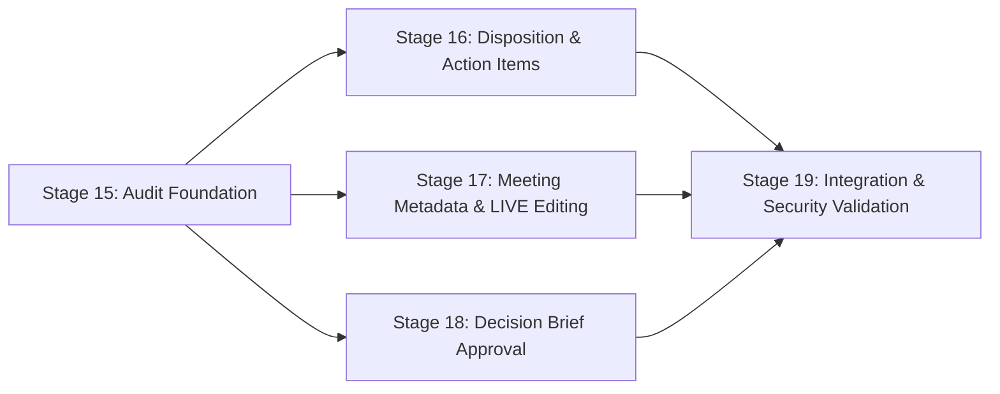

# Stage 14 — Implementation Plan

## 1. Tujuan dan batas

Dokumen ini merencanakan implementasi PD-01 sampai PD-04 berdasarkan source
repository saat ini dan Stage 14 Product Decision Register yang telah
diperbarui dengan keputusan tambahan pemilik proses. Ini adalah
rencana, bukan persetujuan untuk mengubah source, API, database, atau runtime.
Semua endpoint, kolom, dan model baru di bawah adalah usulan; bukan klaim bahwa
fitur tersebut sudah ada.

Stage 14 hanya menghasilkan dokumen perencanaan dan desain teknis. Source,
migration, API contract, dependency, test database, Docker, dan service tidak
diubah atau dijalankan.

## 2. Executive summary

SITARA saat ini adalah modular monolith React/TypeScript + FastAPI +
SQLAlchemy/Alembic + PostgreSQL. Sudah tersedia:

- Minutes sebagai snapshot append-only dengan keputusan terikat pada meeting
  dan `minutes_revision_id`.
- Action Item terikat ke keputusan/revisi tertentu; dapat dibuat berulang dari
  keputusan yang sama, sehingga satu keputusan dapat menghasilkan banyak task.
- Assignment utama dan pendukung dengan pemeriksaan PIC aktif, keanggotaan
  unit, dan organisasi.
- Pengendalian status resmi tetap khusus Sekretariat; progres dan verifikasi
  memiliki histori domain.
- Decision Brief sebagai versi editorial append-only yang terikat ke satu
  revisi minutes dan menandai versi lama stale.
- Lifecycle rapat DRAFT/LIVE/FINAL/ARCHIVED, dengan pemeriksaan minutes yang
  terikat revisi aktif sebelum finalisasi.

Empat gap utama: belum ada resource disposisi; pembuatan Action Item dan
assignment masih hanya untuk Sekretariat; belum ada lifecycle approval Brief;
belum ada update metadata meeting; serta belum ada audit log terpadu. Histori
domain yang ada tidak menggantikan audit log lintas modul.

Rekomendasi urutan menyimpang dari urutan produk PD-01, PD-02, PD-03, PD-04
hanya pada satu hal: bangun **fondasi audit minimum** sebelum perubahan bisnis
lain, lalu lengkapi cakupan audit setelahnya. PRD memberi audit P0 dan
Definition of Done meminta audit event pada tindakan security-relevant;
menambahkan audit belakangan akan memerlukan retrofit transaksi dan pengujian
yang berisiko kehilangan jejak.

## 3. Baseline aktual dan ketidakselarasan dokumen

### 3.1 Source yang diperiksa

Backend: `backend/app/main.py`; model `meeting.py`, `action_item.py`,
`auth.py`; schema `meetings.py`, `action_items.py`; service `meetings.py`,
`action_items.py`, `organization.py`; routes `meetings.py`, `action_items.py`;
migrations `0005`–`0012`; dan test terkait.

Frontend: `frontend/src/api.ts`, `MeetingManagement.tsx`,
`DecisionBriefEditor.tsx`, `ActionItemManagement.tsx`, `Dashboard.tsx`, serta
test komponen terkait. Beberapa frontend tersebut saat ini untracked di Git;
dibaca sebagai source worktree, bukan diasumsikan sudah committed.

Dokumen: [`STAGE_14_PRODUCT_DECISION_REGISTER.md`](./STAGE_14_PRODUCT_DECISION_REGISTER.md),
[`PRD.md`](./PRD.md), [`PROJECT_CONTEXT.md`](../PROJECT_CONTEXT.md),
[`architecture.md`](./architecture.md), [`system_design.md`](./system_design.md),
[`ARCHITECTURE_DECISIONS.md`](./ARCHITECTURE_DECISIONS.md),
[`DEFINITION_OF_DONE.md`](./DEFINITION_OF_DONE.md), dan
[`TEST_STRATEGY.md`](./TEST_STRATEGY.md).

### 3.2 Fakta source dan gap

| Area | Kondisi aktual |
|---|---|
| Keputusan → Action Item | `MinutesDecision` memiliki `is_action_item`, `output_expected`, dan `target_date`. `ActionItem` menyimpan `meeting_id`, `source_minutes_revision_id`, `source_decision_id`. Service memvalidasi keputusan berasal dari revisi aktif dan actionable. |
| Pembuatan/penugasan task | `create_action_item()`, `create_assignment()`, dan `end_assignment()` mensyaratkan operational Secretariat. Create form Action Item sudah memilih sumber meeting/revisi/keputusan, tetapi pengguna masih mengetik ulang judul/deskripsi/output/tenggat dan memasukkan ID PIC mentah. |
| Progress/status | PIC dan pimpinan dengan cakupan organisasi dapat mengirim progres sesuai policy; status resmi dan verifikasi tetap dibatasi ke Secretariat. `ActionItem.version` dan `expected_version` dipakai untuk konflik assignment/status. |
| Decision Brief | `DecisionBriefVersion` dan `DecisionBriefDecision` adalah snapshot append-only, terikat ke satu revisi minutes. Tersedia draft creation dan history; tidak ada approval event/status/API/UI. |
| Metadata meeting | `Meeting` menyimpan metadata inti dan `updated_at`, tetapi belum memiliki `version`. Tidak ditemukan endpoint update metadata; agenda/peserta hanya ditambah melalui POST saat DRAFT. Transition/revision paths mengunci row meeting. |
| Audit | Ada `meeting_status_events`, minutes reviews/revisions, Brief versions, assignment/progress/status/verifications, dan evidence scan events. Tidak ditemukan model/router audit terpadu. Trigger append-only berlaku untuk beberapa tabel snapshot/history, bukan seluruh aktivitas. |

### 3.3 Konflik dokumentasi dan source

- PRD FR-003 (P0) mensyaratkan update metadata; source belum mempunyai jalur
  update. Stage 14 menetapkan edit metadata inti, agenda, dan peserta pada
  DRAFT/LIVE oleh Sekretariat/Rektor/Warek, dengan handover notetaker resmi.
- PRD role descriptions menyatakan Rektor/Warek dapat membuat atau
  mendistribusikan/disposisi task; source membatasi create Action Item dan
  assignment kepada Sekretariat. ADR-004 tetap menetapkan status resmi hanya
  Sekretariat; kewenangan ini tidak boleh tertukar.
- PRD FR-012 (P0) dan Definition of Done mengharuskan audit; architecture
  menyebut audit log sebagai target/model konseptual, tetapi source belum
  menyediakan audit log pusat.
- PRD FR-013 menempatkan Decision Brief sebagai P1 dan menyebut persetujuan
  formal. Stage 14 menetapkan single approver, eligibility FINAL+VALID,
  larangan self-approval, rejection reason, correction-as-new-version, dan
  withdrawal saat pending.
- `PROJECT_CONTEXT.md` menyebut dashboard sintetis/tidak terhubung ke API,
  sedangkan source worktree `Dashboard.tsx` mengambil data melalui API.
  Dokumentasi ini tidak diedit pada Stage 14.
- `system_design.md` juga menjelaskan bahwa workflow UI Action Item masih
  bertahap dan PIC tidak dimasukkan melalui minutes editor; source frontend
  saat ini sudah memiliki Action Item UI terpisah yang memilih sumber keputusan.

## 4. Prioritas, kompleksitas, dan dependency

Kompleksitas S/M/L adalah ukuran relatif luas perubahan, integrasi, dan risiko,
bukan estimasi waktu.

| Urutan | Pekerjaan | Prioritas | Kompleksitas | Dependency |
|---|---|---:|:---:|---|
| 15 | Stage 15 — PD-04 Audit Foundation | P0 | L | Event contract, approved retention/access policies, PostgreSQL migration plan |
| 16 | Stage 16 — PD-01 Disposition & Action Item Authority | P0 | L | Stage 15; org membership/provenance and role policy |
| 17 | Stage 17 — PD-03 Meeting Metadata & LIVE Editing | P0 | M | Stage 15; status/field gates and handover workflow |
| 18 | Stage 18 — PD-02 Decision Brief Approval | P1 | M | Stage 15; FINAL+VALID source state and version event model |
| 19 | Stage 19 — Integration & Security Validation | P0 | L | Stages 15–18; approved isolated PostgreSQL and security/test gates |

PRD menempatkan manajemen metadata dan audit sebagai P0; karena itu PD-03 dan
audit bukan sekadar enhancement. PD-02 direkomendasikan P1 mengikuti FR-013,
namun release yang menjanjikan Brief approved harus menahan fitur tersebut
sampai approval lengkap. PD-01 P0 karena berkaitan dengan tindak lanjut inti
dan pembatasan delegasi.

Stage 16–18 dapat dijalankan sebagai jalur terpisah setelah fondasi audit
diterima, tetapi harus mengikuti urutan Stage 16–19 yang disepakati untuk
release readiness. Migration dan pengujian integrasi perlu dikoordinasikan.

## 5. Rencana pekerjaan per keputusan

### 5.1 PD-01 — Disposisi dan Action Item (P0, L)

**Tujuan:** mencatat arahan sebagai resource yang dapat menghasilkan nol atau
banyak Action Item, dengan sumber keputusan yang tidak diketik ulang.

**Pekerjaan:**

1. Terapkan kebijakan final: Sekretariat/Rektor/Warek dapat menerbitkan
   disposisi, membuat Action Item, serta menunjuk/mengubah PIC lintas unit
   sesuai kewenangan. PIC boleh berasal dari unit mana pun bila ditunjuk
   pejabat yang berwenang. Jangan perluas hak mengubah status resmi/verifikasi
   dari Sekretariat.
2. Desain record disposition yang mereferensikan meeting, exact minutes
   revision dan decision, pemberi arahan, target user/unit/role, waktu, dan
   instruksi. Keputusan final: satu disposition dapat memiliki satu atau lebih
   target user/unit/role yang disimpan sebagai baris terpisah. Jangan menyalin
   teks keputusan sebagai sumber otoritatif.
3. Hubungkan Action Item yang dibuat melalui disposisi dengan disposition ID,
   sambil mempertahankan field sumber yang sekarang. Tugas legacy tidak dapat
   diberi pemberi disposisi historis secara spekulatif.
4. Tambahkan service authorization yang memakai role aktif dari database,
   status/scope meeting, `can_access_task_scope()` dan aturan organisasi.
   Assignment lintas unit mencatat unit asal per assignment dan unit
   penanggung jawab per task. Operator memilih membership asal secara
   eksplisit bila PIC memiliki beberapa membership aktif; backend memvalidasi
   keanggotaan aktif. Jangan memperluas `can_assign_pic()` hanya dengan
   menambahkan role.
5. Ubah UI agar keputusan actionable dipilih dari minutes revision yang
   berwenang; tampilkan teks/hasil/tenggat sumber dan prefill field terkait.
   Pengguna memilih prioritas dan PIC melalui directory terotorisasi; jangan
   memasukkan UUID secara manual. Berikan konfirmasi sebelum membuat task dan
   tampilkan provenance unit asal/penanggung jawab.
6. Tambahkan jalur update terkontrol untuk detail task (termasuk prioritas dan
   due date) dengan `expected_version`; saat ini tidak ditemukan endpoint
   update detail Action Item selain patch status.
7. Tambahkan event audit untuk disposisi, pembuatan task, perubahan assignment,
   PIC, prioritas, dan tenggat.

**File existing yang kemungkinan disentuh:**

- Frontend: `frontend/src/ActionItemManagement.tsx`, `frontend/src/api.ts`,
  tests `ActionItemManagement.test.tsx`; pertimbangkan `MeetingManagement.tsx`
  hanya jika entry point disposisi ditempatkan di halaman rapat.
- Backend: `backend/app/services/action_items.py`,
  `backend/app/services/organization.py`,
  `backend/app/api/routes/action_items.py`,
  `backend/app/api/routes/meetings.py`, `backend/app/main.py` bila router baru
  dipilih; `backend/app/schemas/action_items.py`, `meetings.py`.
- Data: `backend/app/models/action_item.py`, `meeting.py`, model role/org yang
  sudah ada; migration additive Disposition mengikuti `0013_audit_foundation`.
- Tests: `backend/tests/test_action_items.py`, `test_organization.py`,
  `test_meetings.py`, migration tests, dan frontend component tests.

**Status API saat ini:**

- `POST`, `GET /api/v1/meetings/{meeting_id}/dispositions`, dan
  `GET /api/v1/meetings/{meeting_id}/disposition-targets` tersedia. GET dan
  directory dibatasi ke Sekretariat/Rektor/Warek aktif yang berwenang pada
  rapat; PIC, Super Admin, dan pejabat di luar scope ditolak.
- `POST /api/v1/action-items` menerima `disposition_id` opsional dan
  memvalidasi ikatan meeting/revision/decision yang sama. UI rapat membuat
  Disposisi multi-target; UI Action Item dapat memilih Disposisi yang cocok
  dengan keputusan sumber.
- `GET /api/v1/action-items` dan detail tetap memakai API yang ada. Field
  provenance unit telah ditambahkan oleh `0018_action_item_unit_provenance`:
  `responsible_unit_id` disimpan pada Action Item dan `pic_origin_unit_id`
  pada setiap assignment. Field nullable untuk data legacy dan tidak di-backfill.
- Request pembuatan task tidak mewajibkan unit penanggung jawab. PIC utama
  dan assignment baru tetap wajib memilih satu membership aktif sebagai unit
  asal; backend memvalidasi pilihan tersebut pada waktu assignment. Direktori
  mengembalikan membership PIC aktif dan pilihan unit aktif.
- Dedicated `POST /api/v1/dispositions/{disposition_id}/action-items` belum
  diperlukan: pembuatan memakai endpoint Action Item yang sudah ada dan
  `disposition_id` opsional.
- `PATCH /api/v1/action-items/{action_item_id}` masih diperlukan untuk detail
  task yang dapat diubah, memakai `expected_version`; batas role per field
  tetap perlu keputusan.
- Assignment tetap menggunakan endpoint yang ada; authorization service
  diperluas secara policy-driven, bukan dengan melemahkan pemeriksaan.

**Kriteria penerimaan ringkas:**

- Sekretariat/Rektor/Warek dapat memberi disposisi, membuat task, dan
  menunjuk PIC lintas unit sesuai kewenangan; PIC serta Super Admin termasuk
  mixed-role ditolak.
- Disposisi merujuk exact decision/revision pada meeting yang sama.
- Disposisi dapat menghasilkan 0..N tasks; satu decision dapat menghasilkan
  beberapa tasks tanpa menulis ulang teks sumber.
- Tiap Action Item mempertahankan source binding; PIC yang ditunjuk memiliki
  assignment eksplisit; unit asal PIC dan unit penanggung jawab tersimpan.
  Supporting PIC tetap mengikuti aturan assignment.
- Perubahan field task yang diizinkan, prioritas, tenggat, dan PIC memiliki
  otorisasi backend serta konflik versi deterministik.
- Hanya operational Secretariat mengubah status resmi/verifikasi.
- Concurrent assignment menggunakan `expected_version`; konflik menghasilkan
  `409` dan tidak menulis assignment/event setengah jadi.

**Test yang direncanakan:** unit policy per role/scope; API create/read/convert
dan IDOR/cross-meeting/active-revision/`is_action_item=false`; mixed-role
Super Admin; PIC/nonaktif/lintas unit; keputusan menghasilkan 0, 1, atau banyak
task; audit transaction; PostgreSQL constraint/concurrency; frontend prefill,
error/loading, permission visibility. E2E browser: Secretariat atau leader
berwenang memilih keputusan, membuat disposition dan dua Action Items tanpa
mengetik ulang sumber; PIC hanya melaporkan tugasnya; user di luar scope
ditolak oleh API.

**Risiko:** memperluas authority dapat menjadi escalation lintas unit; menautkan
task ke sumber revisi usang; menganggap satu disposition identik dengan satu
task; assignment UI tetap menerima ID tak tervalidasi. Mitigasi: backend object
checks, composite FK, directory server-filtered, policy matrix yang disetujui,
dan preserve status boundary.

### 5.2 PD-02 — Approval Decision Brief (P1, M)

**Tujuan:** satu approver berwenang menyetujui satu versi Brief tertentu; versi
baru tidak mewarisi approval.

**Pekerjaan:**

1. Terapkan submit eligibility yang diputuskan: meeting berstatus `FINAL` dan
   review minutes untuk exact source revision berstatus `VALID`. Larang
   self-approval; submit dapat dilakukan author atau pejabat approver
   (Rektor/Warek/Sekretariat) berwenang dalam scope. Alasan reject wajib;
   correction menghasilkan versi baru; author dapat withdraw hanya saat
   pending dan resubmit versi immutable yang sama.
2. Pertahankan `DecisionBriefVersion` immutable. Simpan lifecycle sebagai
   append-only approval events yang merujuk version ID, termasuk
   `SUBMITTED`, `WITHDRAWN`, `APPROVED`, dan `REJECTED`; resubmission mencatat
   event baru tanpa mengubah isi versi.
3. Kunci meeting/version saat submit/approve/reject/withdraw; validasi versi
   dalam meeting yang diminta, role/scope, status terkini, FINAL state, dan
   review `VALID` untuk revision sumber.
4. Tambahkan response histori approval dan UI yang menampilkan versi sumber,
   status, actor/role/time, alasan reject, withdrawal/resubmission, serta
   conflict.
5. Tambahkan audit event dalam transaksi dengan approval event.

**File existing yang kemungkinan disentuh:**

- Frontend: `frontend/src/DecisionBriefEditor.tsx`, `frontend/src/api.ts`,
  `frontend/src/DecisionBriefEditor.test.tsx`.
- Backend: `backend/app/models/meeting.py`, `backend/app/schemas/meetings.py`,
  `backend/app/services/meetings.py`, `backend/app/api/routes/meetings.py`,
  `backend/app/main.py` bila resource di-router terpisah.
- Migration: `0017_decision_brief_approval` menambahkan tabel event dan guard
  append-only setelah `0016_meeting_live_editing`.
- Tests: `backend/tests/test_meetings.py`, PostgreSQL concurrency/migration
  tests, frontend Decision Brief tests.

**API yang diimplementasikan:**

- `POST /api/v1/meetings/{meeting_id}/decision-briefs/{brief_version_id}/submit`
- `POST /api/v1/meetings/{meeting_id}/decision-briefs/{brief_version_id}/approve`
- `POST /api/v1/meetings/{meeting_id}/decision-briefs/{brief_version_id}/reject`
- `POST /api/v1/meetings/{meeting_id}/decision-briefs/{brief_version_id}/withdraw`
- GET existing `.../decision-briefs` dapat ditambah approval history/status
  tanpa mengubah arti field lama.

**Kriteria penerimaan ringkas:**

- Satu approval oleh salah satu role eligible menyelesaikan approval; tidak ada
  quorum wajib tiga role.
- Approval dan rejection selalu mencatat actor, role yang tervalidasi,
  timestamp, version ID, outcome; tidak ada approval tingkat meeting saja.
- Stale source, scope invalid, PIC, inactive user, Super Admin/mixed-role, dan
  state tidak valid ditolak server-side. Submit ditolak jika rapat bukan
  `FINAL` atau review source revision bukan `VALID`; pemohon submit boleh
  author atau pejabat berwenang dalam scope.
- Author tidak dapat approve versinya sendiri; rejection tanpa alasan ditolak.
- Withdraw hanya berlaku untuk versi `PENDING_APPROVAL`; withdraw/resubmit
  mempertahankan isi dan ID versi serta menambah event history.
- Race dua approver menghasilkan satu terminal event; submit/approve ganda tidak
  menimpa histori.
- Brief version tetap immutable; revisi konten menjadi versi baru dan approval
  versi lama tetap dapat dibaca sebagai histori.

**Verifikasi saat penutupan Stage 18:** regresi backend SQLite lulus 247 tes
dengan coverage 84,17%; seluruh 105 tes frontend lulus. Ruff, Mypy pada
aplikasi dan tes terkait, ESLint, build TypeScript/Vite, Prettier pada file
Stage 18, tes workflow/migration, dan parsing skrip E2E lulus.

**Pembaruan Stage 19:** suite PostgreSQL 16 concurrency/integrity pada target
disposable lulus 18 tes, termasuk perlindungan `TRUNCATE`. Browser E2E belum
dijalankan; persetujuan PostgreSQL tersebut tidak berarti database
development/production digunakan.

**Risiko:** status mutable bertentangan dengan trigger append-only version;
approval pada source yang sudah stale; race dua approver; interpretasi role
campuran yang ambigu. Mitigasi: event table terpisah, lock dan recheck di
transaksi, role selection policy eksplisit, idempotency/conflict tests.

### 5.3 PD-03 — Edit metadata meeting (P0, M)

**Tujuan:** mengedit metadata selama DRAFT atau LIVE, tanpa mengubah alur
lifecycle dan tanpa mengedit snapshot minutes secara terselubung.

**Pekerjaan:**

1. Terapkan kebijakan bahwa Sekretariat/Rektor/Warek dapat mengedit metadata
   inti, agenda, dan peserta pada DRAFT/LIVE; PIC tidak. Tentukan allowlist
   field teknis tanpa membuka `meeting_number`, creator, atau lifecycle fields
   secara tidak sengaja.
2. Tambahkan schema update terpisah dari `MeetingCreate` dengan `extra="forbid"`
   dan validasi field/time/reference.
3. Tambahkan service patch yang mengunci row meeting, cek status DRAFT/LIVE,
   membandingkan `expected_version`, memperbarui hanya allowlist, increment
   version dan mencatat history/audit pada transaksi yang sama.
4. Tambahkan UI edit dengan dirty-state, version, 409 conflict handling,
   permission-aware control, dan server error. Tetap pisahkan aksi transisi.
5. Agenda/peserta adalah resource tersendiri saat ini; ubah status gate secara
   terarah agar ketiganya hanya dapat mengelola pada DRAFT/LIVE. Jangan
   memperluas gate tanpa role/object authorization.
6. Untuk handover LIVE, izinkan current notetaker atau Sekretariat mengajukan
   permintaan; satu Sekretariat/Rektor/Warek berwenang dapat menyetujui.
   Pergantian efektif hanya setelah approval dan harus diaudit.
7. FINAL/ARCHIVED tidak dapat diedit langsung. Koreksi formal memerlukan
   keputusan terpisah dan record amendment append-only jika memang diperlukan.

**File existing yang kemungkinan disentuh:**

- Frontend: `frontend/src/MeetingManagement.tsx`, `frontend/src/api.ts`,
  `frontend/src/MeetingManagement.test.tsx`.
- Backend: `backend/app/models/meeting.py`, `backend/app/schemas/meetings.py`,
  `backend/app/services/meetings.py`, `backend/app/api/routes/meetings.py`.
- Migration: tambah `Meeting.version` (default/backfill 1) dan metadata history
  jika tidak menggunakan audit events sebagai history lengkap.
- Tests: `backend/tests/test_meetings.py`, migration tests, meeting
  concurrency tests.

**Proposed API (belum ada):** `PATCH /api/v1/meetings/{meeting_id}` dengan
`expected_version`; response menambahkan `version`. Jangan gunakan POST create
atau transition route untuk update.

**Kriteria penerimaan ringkas:**

- Sekretariat/Rektor/Warek berwenang dapat mengubah metadata inti, agenda, dan
  peserta pada DRAFT/LIVE sesuai object scope; PIC ditolak oleh API.
- FINAL/ARCHIVED selalu ditolak dengan `409`; status, minutes revision, review,
  dan transition event tetap tidak berubah.
- `meeting_number`, creator, status, timestamps lifecycle tidak dapat
  diubah melalui body update.
- Reference user harus aktif; keunikan nomor dan validasi waktu tetap berlaku.
- Update mengunci meeting dan memakai expected version; update stale/race
  finalisasi menghasilkan konflik tanpa partial write.
- Audit event menyimpan perubahan terpilih, bukan minutes/dokumen penuh.
- Handover hanya efektif setelah permintaan oleh current notetaker/Sekretariat
  disetujui satu Sekretariat/Rektor/Warek; notetaker lama tetap aktif sampai
  approval berhasil.

**Test yang direncanakan:** unit field allowlist/status/validation; API CSRF,
roles/object scope, DRAFT/LIVE/FINAL/ARCHIVED, field forbidden, stale version;
PostgreSQL race update-vs-finalize; frontend visibility, prefill, cancel,
unsaved changes, 409 reload/merge. E2E browser: edit pada DRAFT dan LIVE,
finalisasi rapat, lalu pastikan update ditolak pada FINAL dan ARCHIVED.

**Risiko:** beberapa editor inti dapat mengirim revisi dari base yang sama;
perubahan notetaker saat LIVE hanya mengubah atribusi, bukan daftar editor.
Mitigasi: integer `base_revision_id`, row lock, penolakan konflik `409`,
validasi status di dalam transaksi, dan lifecycle fields yang immutable.

### 5.4 PD-04 — Centralized Audit Log (fondasi P0, coverage P0, L)

**Tujuan:** satu event contract yang aman, dapat ditelusuri, append-only, dan
tidak menggantikan domain history yang berfungsi sebagai workflow records.

**Pekerjaan:**

1. Tetapkan event catalog, role snapshot, outcome, allowlist before/after,
   correlation ID, dan strategi archive yang memenuhi retensi final: minimal
   lima tahun atau kebijakan arsip resmi ITPLN yang lebih lama.
2. Tambahkan tabel append-only terpisah dan writer eksplisit; jangan membuat
   scan event atau history domain menjadi queue/status audit umum.
3. Pasang writer pada transaksi sukses untuk mutation penting. Jika audit event
   wajib gagal ditulis, transaksi bisnis terkait rollback dan error terlihat.
4. Untuk denied/failed request yang tidak memiliki transaksi sukses, tulis
   outcome `DENIED`/`FAILED` melalui jalur audit setelah rollback. Jika
   pencatatan denial gagal, pertahankan response penolakan dan terbitkan
   operational alert; jangan mengubah denial menjadi sukses.
5. Implementasikan append-only protections dan pisahkan runtime DB role dari
   migration/schema owner. Trigger bukan perlindungan terhadap superuser.
6. Tambahkan API pembacaan/export dengan policy final: semua Sekretariat
   operasional dapat membaca semua log; Rektor/Warek hanya event objek dalam
   scope bisnis masing-masing. Grant ekstra eksplisit hanya dapat diberikan/
   dicabut pejabat pemilik grant yang ditunjuk. Super Admin tidak otomatis
   berhak. Catat seluruh read/export; jangan memberi akses implicit ke minutes.
7. Integrasikan coverage seluruh modul dan tes kelengkapan event/privilege.

**File existing yang kemungkinan disentuh:**

- Backend: `backend/app/main.py`, `backend/app/models/meeting.py`,
  `action_item.py`, `auth.py`, services/routes yang memutasi modul,
  `backend/app/core` atau middleware yang menangani request context.
- Proposed new backend audit model/service/router dan migration; lokasi/nama
  file baru harus mengikuti pola package yang disetujui.
- Tests: test modules setiap service mutation, `backend/tests/conftest.py`,
  migration tests, API authorization tests, PostgreSQL integrity tests.
- Frontend reader (jika disetujui): `App.tsx`, API client, serta halaman audit
  baru; tidak termasuk fondasi write API.

**Kriteria penerimaan ringkas:**

- Semua operasi yang tercantum dalam PD-04 memiliki actor/role/action/object/
  timestamp/outcome dan correlation ID; before/after hanya untuk field
  non-sensitif.
- Tidak ada password, token, secret, evidence bytes, atau isi minutes/Brief
  lengkap pada event.
- Mutasi sukses dan event atomik; event `DENIED` tidak menyatakan sukses.
- App runtime tidak dapat UPDATE/DELETE/TRUNCATE audit rows; owner/DDL
  privilege terpisah; kontrol dan keterbatasan superuser terdokumentasi.
- Semua Sekretariat operasional membaca semua log; Rektor/Warek hanya event
  dalam scope masing-masing; grant tambahan diberikan/dicabut oleh pejabat
  pemilik grant yang ditunjuk. Super Admin tidak otomatis berhak.
- Read/export menghasilkan audit event sebelum data dikembalikan tanpa
  rekursi tanpa batas.
- Retensi minimal lima tahun atau kebijakan resmi ITPLN yang lebih lama;
  mekanisme archive/disposal tidak boleh menghapus sebelum ketentuan itu.

**Test yang direncanakan:** schema/allowlist sanitizer; success transaction dan
rollback; denial outcome; immutable insert/update/delete/truncate di SQLite
dan PostgreSQL; role/scope/redaction; correlation ID propagation; migrasi
kosong dan dari versi sebelumnya; event coverage assertions pada seluruh
mutation paths. E2E browser: aktor berwenang menjalankan satu aktivitas
perwakilan per modul dan auditor yang berwenang melihat event yang telah
di-redact; PIC serta role tanpa izin tidak dapat membaca event/objek terbatas.

**Risiko:** audit event menyimpan konten sensitif; logging gagal tetapi operasi
tetap sukses; pembaca audit dapat melihat konten terlarang; overload/retensi
tidak terbatas. Mitigasi: typed event catalog, allowlist field, fail-closed
transaction policy, reader authorization/redaction, kapasitas/retensi
disetujui, privilege terpisah.

## 6. Definition of Done per fase

### Fase 0 — Kebijakan dan contracts

- Keputusan produk PD-01–PD-04 yang tercatat di register diterjemahkan menjadi
  matriks role/scope, state transitions, event catalog dan negative acceptance
  tests.
- Selesaikan hanya detail teknis yang belum ditetapkan, termasuk asal unit
  untuk PIC multi-membership, grant-owner
  identity, actor anonim/system, dan lifecycle archive/disposal.
- API request/response dan migration compatibility ditinjau sebelum coding;
  tidak boleh mengubah keputusan produk tanpa persetujuan baru.

### Fase 1 — Audit foundation

- TDD Red/Green/Refactor mengikuti [`TEST_STRATEGY.md`](./TEST_STRATEGY.md).
- Migration additive, upgrade dari database kosong dan versi existing
  terisolasi, downgrade behavior terdokumentasi (jangan destructive).
- Audit transaction atomicity, authorization, privacy, append-only, backend
  checks dan test terkait lulus.

### Fase 2 — PD-01

- Server authorization matrix ditegakkan; source decision binding tidak
  berubah; satu keputusan menghasilkan nol/banyak tasks.
- UI tidak meminta data keputusan/PIC diketik ulang secara tidak perlu.
- Regression Action Item/evidence/status/PIC access berjalan; status resmi
  Secretariat-only tetap terjaga.

### Fase 3 — PD-03

- Update DRAFT/LIVE berhasil sesuai allowlist; FINAL/ARCHIVED immutable lewat
  endpoint langsung maupun UI.
- Konflik stale dan race transition ditangani konsisten.
- Histori/audit metadata lengkap; minutes/review/finalization invariant lulus.

### Fase 4 — PD-02

- Single approver workflow lengkap dari submit sampai terminal event.
- Approval selalu version-bound, immutable, berotorisasi, dan memiliki
  rejection/stale behavior yang disetujui.
- Concurrent approve, re-submit, source revision baru, dan mixed-role tests
  lulus.

### Fase 5 — Audit coverage dan release readiness

- Event coverage menutup setiap aktivitas PD-04, access log/export,
  redaction, retention dan monitoring.
- Backend unit/API/PostgreSQL test, frontend tests/typecheck/build, lint,
  security scans, migration review, git diff/secrets review, serta independent
  review sesuai Definition of Done. Tidak ada hasil yang diklaim tanpa run.

## 7. Risiko lintas pekerjaan dan release gate

| Risiko | Dampak | Kontrol/gate |
|---|---|---|
| Perubahan authorization lebih luas dari scope hierarchy | Data leakage / penugasan lintas unit | Owner-approved matrix, server-side object checks, mixed-role negative tests |
| Historis source revision sudah stale | Action Item/approval menunjuk sumber bukan current | Simpan exact source IDs; validasi active revision untuk operasi baru; jangan ubah histori |
| Approval status disimpan pada versi immutable | Histori tertimpa/invalid | Approval event terpisah dan append-only |
| Meeting update berpacu dengan finalization | Status/metadata inconsistent | Lock meeting row, expected version, satu transaksi |
| Audit payload mencakup restricted content | Kebocoran minutes/evidence/secret | Allowlist field/event, redaction tests, no raw ORM dump |
| Audit writer gagal | Perubahan bisnis tanpa jejak | Mutasi penting rollback; ops alert untuk denial/failure write |
| Migration menyentuh data existing | Downtime/data loss | Additive, nullable/defaults yang aman, expand-migrate-contract, isolated PG rehearsal |
| Pekerjaan lokal belum committed | Perbedaan basis implementasi/review | Catat commit dan worktree state pada awal coding; jangan menimpa perubahan pengguna |

## 8. Detail desain teknis tersisa

Keputusan produk sudah ditutup; hal berikut memerlukan pemilihan teknis sebelum
implementasi, tanpa mengubah policy yang disepakati:

1. Cara menentukan `pic_origin_unit_id` bila PIC memiliki beberapa membership
   aktif diselesaikan pada 16 November 2026: operator memilih membership asal
   secara eksplisit dari direktori dan backend memvalidasi membership aktif.
   `responsible_unit_id` tetap tersedia untuk data lama, tetapi tidak wajib
   diisi pada tindak lanjut baru; `pic_origin_unit_id` tetap mencatat asal PIC.
2. Identitas aktor untuk aktivitas anonim/system serta pejabat pemilik grant
   audit yang ditunjuk secara resmi.
3. Proses archive/disposal setelah masa retensi minimal lima tahun atau masa
   yang lebih panjang sesuai kebijakan resmi ITPLN. Tidak boleh menghapus
   event sebelum waktunya.
4. Field metadata inti yang dapat diedit, khususnya status `meeting_number`
   setelah rapat dibuat. Field allowlist tidak boleh mencakup lifecycle/system
   fields, dan tidak mengubah FINAL/ARCHIVED menjadi editable.
6. Role mana yang dapat menetapkan/mengubah prioritas dan tenggat Action Item,
   serta apakah pembuat task dapat mengubahnya setelah task dibuat. Jangan
   asumsikan hak tersebut hanya dari wewenang membuat task atau menetapkan PIC.
7. Representasi role snapshot ketika seorang pengguna memiliki lebih dari
   satu role yang memenuhi syarat; authorization final tetap menghormati
   pengecualian Super Admin.
8. Kebijakan akses audit untuk grant tambahan harus mengidentifikasi pejabat
   grant-owner dan merekam grant/revoke. Read/export tetap dicatat tanpa
   rekursi tak terbatas.
9. Kebijakan koreksi/amendment setelah FINAL/ARCHIVED belum diputuskan; untuk
   saat ini direct edit tetap dilarang.

## 9. Kondisi Git dan verifikasi Stage 14

Pemeriksaan akhir: branch `integration/sitara-main-sync`, HEAD
`42e4d9373779581a985ffc9808653ec5c49919c5`; 30 modified tracked, 14
untracked, 0 staged, dan 0 deleted. Ketiga dokumen Stage 14 adalah untracked;
perubahan worktree lainnya tetap dipertahankan.

Tahap ini bersifat dokumentasi saja. Tidak dijalankan test aplikasi, lint,
migration, database, Docker, deployment, atau service.

## 10. PD-01 assignment audit follow-up (2026-11-16)

Assignment additions, main PIC replacements, and supporting-PIC endings now
write redacted audit events in the same transaction. A missing audit write
rolls back the assignment mutation. The additive migration is `0019` after
`0018_action_item_unit_provenance`; SQLite API and migration tests cover the
new behavior. PostgreSQL, browser E2E, and runtime migration were not run.
