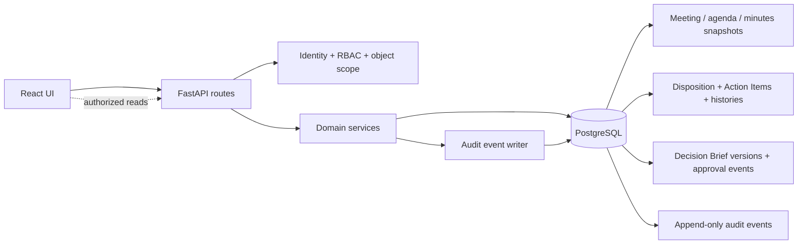

# Stage 14 — Technical Design

## 1. Status dan batas desain

Ini adalah target design berbasis source worktree SITARA saat ini, bukan
implementasi atau persetujuan untuk mengubah source/API/database. Nama
endpoint, tabel, field dan state baru yang diawali sebagai usulan belum ada di
repository. Keputusan yang mengubah kewenangan, retensi, atau akses memerlukan
persetujuan pemilik proses sebelum implementasi.

Stack tetap modular monolith: React + TypeScript, FastAPI, SQLAlchemy,
PostgreSQL dan Alembic. Tidak ada dependency, service, worker, atau broker baru
yang diperlukan untuk desain ini.

## 2. Arsitektur target

Pertahankan modul meeting/minutes, Action Item, Decision Brief dan identity
yang berjalan sekarang. Tambahkan audit event sebagai cross-cutting service
yang dipanggil dari service transaksi bisnis; jangan pindahkan domain rules ke
frontend atau menjadikan audit log sumber state workflow.



Satu transaksi bisnis mengubah row domain dan menulis event audit yang
berkaitan. Notification, export, dan external services tidak ditambahkan
dalam desain ini.

## 3. Fakta implementasi yang menjadi dasar

- Router saat ini didaftarkan di `backend/app/main.py`; router business adalah
  `meetings` dan `action_items`.
- Meeting menyimpan metadata inti, `status`, `started_at`, `finalized_at`,
  `finalized_by_id`, `created_at`, `updated_at`. Belum ada integer version.
- Lifecycle transition mengunci row `Meeting` dan menyimpan
  `MeetingStatusEvent` bersama perubahan status. Minutes revision append
  mengunci meeting dan membandingkan `base_revision_id`.
- `MinutesDecision` memiliki `meeting_id`, `minutes_revision_id`,
  `decision_text`, `output_expected`, `target_date`, dan `is_action_item`.
- `ActionItem` telah mempunyai exact composite reference ke meeting/source
  revision/source decision. Service hanya menerima revisi aktif dan decision
  actionable; setiap create menambahkan satu task. Model tidak menunjukkan
  unique decision-to-task constraint, sehingga 0..N dapat dipertahankan.
- Assignment mendukung `MAIN`/`SUPPORTING`; service menggunakan
  `ActionItem.version`, row lock, dan `expected_version` untuk konflik.
- `can_access_task_scope()` memeriksa role aktif, Super Admin, assignee
  tersimpan, unit membership dan reporting graph. `can_assign_pic()` sekarang
  hanya menerima operational Secretariat dan PIC aktif yang memiliki
  membership unit aktif.
- Brief version/decisions append-only dan exact-revision-bound. API saat ini
  hanya membuat dan membaca history; `is_stale` dihitung dari active minutes
  revision. Tidak ada approval model/route.
- Domain histories tersedia, tetapi tidak ditemukan centralized audit model,
  router, atau audit middleware. `meeting_status_events` adalah lifecycle
  history, bukan event log lintas modul.
- `frontend/src/ActionItemManagement.tsx` memilih source decision tetapi masih
  menampilkan input kosong untuk title/description/output/due date dan ID PIC.
  `DecisionBriefEditor.tsx` menyimpan version sebagai draft. `MeetingManagement.tsx`
  mempunyai create/detail/lifecycle, bukan metadata update.

## 4. Matriks RBAC yang telah diputuskan

Semua izin mensyaratkan akun aktif, pemeriksaan backend, object scope, dan
status workflow. UI permission hanya UX. Keputusan memberi role authority
berdasarkan scope organisasi; detail predicate per objek harus diimplementasi
server-side. Super Admin tidak memperoleh business permission otomatis,
termasuk pada akun mixed-role.

| Aksi | Sekretariat operasional | Rektor | Warek | PIC | Super Admin |
|---|---|---|---|---|---|
| Baca minutes/Brief | Sesuai akses operasional | Dalam scope meeting | Dalam scope meeting | Tidak untuk konten penuh | Tidak |
| Buat disposition ke user/unit/role | Ya, sesuai kewenangan | Ya, sesuai kewenangan | Ya, sesuai kewenangan | Tidak | Tidak |
| Buat Action Item | Ya | Ya | Ya | Tidak | Tidak |
| Tetapkan/ubah PIC lintas unit | Ya, jika ditunjuk secara eksplisit | Ya, jika ditunjuk secara eksplisit | Ya, jika ditunjuk secara eksplisit | Tidak | Tidak |
| Progress/report/bukti | Sesuai operational access | Sesuai scope | Sesuai scope | Hanya task yang ditugaskan | Tidak |
| Ubah status resmi/verifikasi | Ya, jika Secretariat berwenang | Tidak | Tidak | Tidak | Tidak |
| Submit Decision Brief | Ikuti policy submit dan source eligibility | Ikuti policy submit dan source eligibility | Ikuti policy submit dan source eligibility | Tidak | Tidak |
| Approve/reject Brief | Ya, kecuali author versi tersebut | Ya, kecuali author versi tersebut | Ya, kecuali author versi tersebut | Tidak | Tidak |
| Withdraw Brief | Hanya pembuat versi saat pending | Hanya pembuat versi saat pending | Hanya pembuat versi saat pending | Tidak | Tidak |
| Edit metadata/agenda/peserta DRAFT/LIVE | Ya, sesuai scope | Ya, sesuai scope | Ya, sesuai scope | Tidak | Tidak |
| Request notetaker handover LIVE | Sekretariat atau notetaker aktif | Notetaker aktif | Notetaker aktif | Notetaker aktif jika current | Tidak |
| Approve notetaker handover | Ya | Ya | Ya | Tidak | Tidak |
| Read audit | Semua log | Event objek dalam scope | Event objek dalam scope | Tidak untuk audit umum | Tidak otomatis |
| Grant/revoke additional audit access | Hanya pejabat pemilik grant yang ditunjuk | Sesuai penunjukan formal | Sesuai penunjukan formal | Tidak | Tidak otomatis |

PIC lintas unit boleh ditunjuk oleh pejabat berwenang; simpan unit asal PIC dan
unit yang bertanggung jawab atas pekerjaan. Assignment tidak memberi PIC akses
ke seluruh minutes, kemampuan membuat task, atau hak mengubah status resmi.
Sekretariat operasional dapat membaca seluruh audit log; pembatasan leader
dilakukan pada scope objek bisnis, bukan filter UI. Read/export audit juga
dicatat. ADR-004 tetap menjaga status resmi dan completion verification khusus
Sekretariat.

## 5. PD-01 — Disposition → Action Item

### 5.1 Process

1. Client mengambil meeting, revision, dan decision dari API yang sudah
   mengotorisasi minutes scope.
2. Pengguna membuat disposition terhadap exact source decision. Backend
   memuat role/current organization dari database; tidak mempercayai role,
   actor, assignee atau meeting source dari payload tanpa validasi.
3. Disposition dapat tetap tanpa Action Item. Bila tindak lanjut diperlukan,
   pengguna membuat satu atau lebih Action Items darinya.
4. Backend memuat teks keputusan, output, tanggal target dan `is_action_item`
   dari `MinutesDecision`. UI menampilkan source tersebut dan melakukan
   prefill; keputusan sumber tidak diduplikasi sebagai sumber kebenaran. Task
   description dapat menampung instruksi spesifik disposition.
5. PIC utama/supporting dapat berasal dari unit mana pun bila ditunjuk secara
   eksplisit oleh Sekretariat/Rektor/Warek yang berwenang. Backend mencatat
   unit asal PIC dan unit penanggung jawab pekerjaan serta membatasi akses PIC
   ke task/dokumen yang ditugaskan.
6. Action Item menyimpan exact source revision/decision dan referensi
   disposition; progress tetap terpisah dari status resmi.

```mermaid
sequenceDiagram
  actor U as Secretariat/Rektor/Warek
  participant UI as React
  participant API as FastAPI
  participant DB as PostgreSQL
  U->>UI: Pilih meeting/revision/decision
  UI->>API: GET authorized source
  API->>DB: Check role, meeting scope, active source
  DB-->>API: Decision fields + source IDs
  API-->>UI: Authorized source data
  U->>UI: Submit disposition
  UI->>API: POST disposition(source revision + decision)
  API->>DB: Lock/check source, write disposition + audit
  DB-->>API: Commit
  API-->>UI: Disposition
  U->>UI: Create 0..N Action Items
  UI->>API: POST Action Item(s) from disposition
  API->>DB: Check role/PIC/source; write task + assignment + status history + audit
  DB-->>API: Commit
```

### 5.2 Data model proposal

New `Disposition` record (table name subject to naming review):

- `id`, `meeting_id`, `source_minutes_revision_id`, `source_decision_id`
- `issued_by_user_id`, event timestamp, optional instruction/body
- target kind (`USER`, `UNIT`, or `ROLE`) and target identifier; all three
  target kinds are required product capabilities
- optional correlation ID or link to audit event
- unique/foreign-key constraints bind source decision to the exact meeting and
  revision; no copied authoritative decision text.

Extend `ActionItem` with nullable `disposition_id` and `responsible_unit_id`;
store `pic_origin_unit_id` on each `ActionItemAssignment` so every main,
supporting, and replacement assignment keeps its own origin. Maintain the
current required exact
source fields and composite FK. A composite FK/constraint should ensure that a
linked disposition and Action Item refer to the same meeting, revision and
source decision. Existing rows remain nullable; do not backfill an issuing
disposition, PIC origin, or responsible unit that was never recorded. The
Action Item row plus current assignment table remains the task/recipient
relationship. For a PIC with multiple active memberships, the operator
explicitly selects the origin unit and the backend validates it at assignment
time. The responsible work unit is selected independently.

The final product decision allows one disposition to address multiple targets
simultaneously. Store each user, organization-unit, or role target in a
separate `disposition_targets` row linked to its disposition. Disposition is
not a scanner queue or a replacement for append-only minutes decisions.

### 5.3 API status and remaining proposals

- `POST /api/v1/meetings/{meeting_id}/dispositions` is implemented as the
  initial Stage 16 slice. It creates a disposition with one or more
  user/unit/role targets, verifies meeting scope and exact active
  minutes-revision/decision binding, and writes `disposition.created`
  atomically with the disposition.
- `GET /api/v1/meetings/{meeting_id}/dispositions` and
  `GET /api/v1/meetings/{meeting_id}/disposition-targets` are implemented.
  Both require an active Secretariat/Rektor/Warek identity with access to the
  meeting; PIC, Super Admin (including mixed-role accounts), and officials
  outside the meeting scope are denied. Directory output contains active user
  names/titles, active units, and role labels, but no email or credential
  fields. User options are paginated.
- The frontend creates Dispositions from an active minutes decision in the
  meeting detail view. Action Item creation can link a Disposition only when
  its meeting, source revision, and decision match the selected source.
- A dedicated `POST /api/v1/dispositions/{disposition_id}/action-items` is
  not implemented; the existing `POST /api/v1/action-items` accepts the
  optional `disposition_id` for backward compatibility.
- Existing `POST /api/v1/action-items` is the current Action Item creation
  endpoint. Its request includes meeting, source revision, source decision,
  task fields, main PIC ID, selected main PIC origin unit, responsible unit,
  and optional `disposition_id`. Assignment creation also requires a selected
  PIC origin unit.
- `PATCH /api/v1/action-items/{action_item_id}` is a proposed new update
  endpoint for editable task detail, priority and due date, with
  `expected_version`. No current detail-update route was found; the existing
  `PATCH /api/v1/action-items/{action_item_id}/status` only changes official
  status and must remain distinct.
- Existing assignment endpoints remain; backend authorization expands to the
  three approved roles and explicitly authorized cross-unit PIC assignments.
  Preserve Secretariat-only status mutation and completion verification.

Every write requires CSRF and object-level scope checks, and returns a stable
response schema. Cross-meeting or stale source IDs are rejected.

### 5.4 Migration and compatibility

At design time, migration `0014_dispositions` added the disposition and target
tables and extended the audit event action/object constraints. Stage 16
subsequently added `0015_action_item_dispositions`, linking Action Items to an
optional disposition with an exact meeting/revision/decision composite foreign
key and recording `action_item.created` in the same transaction. Existing
Action Items remain valid without a disposition. The current schema permits a
decision to be referenced by multiple Action Items; the migrations have been
verified with isolated SQLite tests but not PostgreSQL integration or a runtime
database.

## 6. PD-02 — Version-bound Decision Brief approval

### 6.1 Lifecycle

Keep Brief content/version immutable and append workflow events to a separate
table. Proposed displayed states:

`DRAFT → PENDING_APPROVAL → APPROVED`
or
`DRAFT → PENDING_APPROVAL → REJECTED`.
After pending withdrawal, the same version is eligible for a later submission:
`PENDING_APPROVAL → WITHDRAWN → PENDING_APPROVAL`.

- Draft is represented by absence of a submission event.
- Submit is allowed only when the meeting is `FINAL` and the minutes review
  for the version's exact source revision is `VALID`; `SUBMITTED` yields
  pending.
- One eligible approver adds one terminal `APPROVED` or `REJECTED` event.
- The version author cannot approve their own version. Rejection requires a
  non-empty reason and is terminal for that version; correction requires a
  new `DecisionBriefVersion`.
- The author may withdraw only while pending. Withdrawal does not mutate the
  version content; the same immutable version may be submitted again and each
  attempt remains in event history.
- Approval is permanent history for its version. If a later minutes revision
  appears, the Brief can additionally be displayed as stale, without rewriting
  approval.

### 6.2 Data model proposal

The append-only `decision_brief_approval_events` table:

- `id`, `meeting_id`, `brief_version_id`, per-version `event_number`
- `event_type` (`SUBMITTED`, `WITHDRAWN`, `APPROVED`, `REJECTED`)
- `actor_user_id`, validated role snapshot/acting role
- `occurred_at`, optional non-sensitive note, optional correlation ID
- composite FK to the same meeting's Brief version
- unique `(brief_version_id, event_number)`; constraints/state validation allow
  repeated submit only after withdrawal, enforce one pending period at a time,
  and limit a version to one terminal decision.

Derive current status from the ordered events or expose a transactional
projection. Do not add a mutable status column to the append-only
`DecisionBriefVersion`. If performance later warrants a projection, it must be
reconstructible and transactionally consistent with the events.

### 6.3 Authorization, concurrency, and API

Implemented endpoints:

- `POST /api/v1/meetings/{meeting_id}/decision-briefs/{brief_version_id}/submit`
- `POST /api/v1/meetings/{meeting_id}/decision-briefs/{brief_version_id}/approve`
- `POST /api/v1/meetings/{meeting_id}/decision-briefs/{brief_version_id}/reject`
- `POST /api/v1/meetings/{meeting_id}/decision-briefs/{brief_version_id}/withdraw`
- Existing `GET /api/v1/meetings/{meeting_id}/decision-briefs` can return
  current state and event history, subject to existing restricted Brief
  authorization.

Each operation locks the meeting row, verifies the version belongs to the
meeting, checks the actor's active role and scope, and validates the latest
workflow event. Submit is available to the version author or an in-scope
authorized Rektor, Warek, or Secretariat user; it also checks the exact source
revision's review state. Approve/reject rejects the version author to prevent
self-approval; rejection validates a required non-empty reason. Withdraw is
limited to the author and pending state. Two simultaneous approvers yield
exactly one terminal event; the other receives a conflict. The verified role
snapshot is persisted with the action.

### 6.4 Migration and tests

Migration `0017_decision_brief_approval`, after `0016_meeting_live_editing`,
adds the event table and append-only controls. Existing Brief versions/decision
rows remain unchanged and begin as drafts (no fabricated approvals). Read
schema fields do not change existing source IDs or stale calculation. SQLite
migration and workflow tests cover existing Brief history, forbidden row
mutation, FINAL+VALID submission, non-author authorized submission, author
self-approval denial, required rejection reason, withdrawal/resubmission, and
one approver. Stage 19 ran the PostgreSQL 16 concurrency/integrity suite on an
approved disposable target: 18 tests passed, including race and `TRUNCATE`
guards. Browser E2E remains unverified.

## 7. PD-03 — Meeting metadata update

### 7.1 Field and lifecycle policy

Add a PATCH service for DRAFT/LIVE. Sekretariat/Rektor/Warek with meeting
scope may edit core metadata, agenda, and participants; PIC may not. FINAL and
ARCHIVED reject direct edits. Candidate editable metadata fields:

- `title`, `meeting_type`, `meeting_date`, `start_time`, `end_time`,
  `location`, `chairperson_id`.
- `notetaker_id` is not directly editable during LIVE. A formal handover
  request may be initiated by the current notetaker or Secretariat and approved
  by one authorized Secretariat/Rektor/Warek; only then does the active
  notetaker change. Record request, approver, old/new notetaker and timestamps.
- `meeting_number` remains manual and unique, but recommendation is immutable
  after create; correcting an official number requires a separate owner-approved
  amendment, not silent update.
- `created_by_id`, `status`, `started_at`, `finalized_at`,
  `finalized_by_id`, `created_at` and `updated_at` are never body-editable.
Agenda/participants are separate resources today, but the approved policy
explicitly allows their changes by Secretariat/Rektor/Warek in DRAFT/LIVE.
Update their authorization and status gates deliberately; do not rely on UI
visibility or broaden `_require_editable_draft()` without role/scope checks.

FINAL and ARCHIVED reject direct metadata mutation. A correction/amendment
workflow is outside the present decision and must not reopen lifecycle.

### 7.2 Endpoint and concurrency

Proposed new contract: `PATCH /api/v1/meetings/{meeting_id}` with a dedicated
`MeetingMetadataUpdate` schema and required `expected_version`. Add integer
`Meeting.version` default/backfill 1 and expose it in response. This is
consistent with Action Item `version`/`expected_version`; use a row lock as the
serialization guard already used by transition/revision services. A stale
version, or status changing to FINAL before the patch obtains the lock, returns
`409` without partial changes.

Use schema `extra="forbid"` and per-field validation; reject lifecycle/system
fields rather than silently ignore them. Validate active chairperson/notetaker,
meeting time order, and unique manual number. Record a redacted before/after
metadata event in the same transaction.

### 7.3 Frontend and backwards compatibility

Add an explicit edit mode to `MeetingManagement.tsx`; keep create and lifecycle
forms separate. Populate from latest GET detail. On `409`, preserve local
unsaved values and provide a controlled reload/reconcile action; never
automatically overwrite another user's change. Disable field UI for FINAL/
ARCHIVED but rely on API denial as security boundary.

Adding response `version` is additive. New PATCH is additive; existing POST
create, agenda/participant, minutes, review and transition contracts remain
unchanged. If client response parsing is strict, update TS types/tests in the
same release.

### 7.4 Migration and history

Add `version INTEGER NOT NULL DEFAULT 1` with positive check. Existing meeting
rows need no semantic backfill other than version 1. Audit events provide
history; a second mutable `meeting_metadata_history` table is unnecessary if
the event catalog can preserve every authorized field change. If a formal
history must remain directly queryable by domain, add a separate append-only
record in the same transaction rather than editing `MeetingStatusEvent` (which
only models lifecycle transition).

## 8. PD-04 — Centralized audit event design

### 8.1 Event schema proposal

Proposed `audit_events` table:

| Field | Type/purpose |
|---|---|
| `id` | UUID event identifier |
| `occurred_at` | UTC server timestamp |
| `actor_user_id` | Nullable for unauthenticated/system actors; FK policy must preserve history after account lifecycle changes |
| `actor_roles` | Snapshot of verified role codes at event time, not client claims |
| `action` | Controlled event code, e.g. `action_item.pic_changed` |
| `object_type`, `object_id` | Generic resource identity; validate UUID where applicable |
| `result` | Controlled `SUCCEEDED`, `DENIED`, `FAILED` result |
| `correlation_id` | Request/job correlation value generated or validated by trusted middleware |
| `before_values`, `after_values` | Optional allowlisted JSONB; never serialize ORM models wholesale |
| `metadata` | Small, schema-controlled nonsensitive context only |

Index by `(object_type, object_id, occurred_at)`, `(actor_user_id, occurred_at)`,
and `(action, occurred_at)` after query patterns are measured. No index or
payload should contain secrets or evidence content. Retention is at least five
years or longer when official ITPLN archival policy requires it. Partitioning
and disposal mechanics remain technical decisions and cannot shorten retention.

For role snapshot semantics, either persist a verified `acting_role` plus the
complete role-code snapshot, or only role codes and derive a display label
from an immutable code catalog. Do not store mutable human-readable names as
authority.

### 8.2 Event taxonomy

Minimum events include:

- Meeting created, permitted metadata changed, agenda/participant changed,
  lifecycle transition.
- Minutes revision created, review recorded.
- Decision source marked actionable and disposition created.
- Brief version created/submitted/withdrawn/approved/rejected.
- Action Item created; assignment created/ended; main/supporting PIC changed;
  priority/due date changed; official status changed; progress submitted;
  completion verified/revision requested.
- Evidence uploaded, scan result recorded, and evidence download/denial where
  policy requires it. Record metadata/checksum reference only, never file bytes.
- User activation/role/membership/permission administration and audit read/
  export.

Existing status/revision/assignment/progress/evidence histories remain
authoritative for their domain workflows. Audit events provide cross-module
attribution and correlation; they should link to domain records rather than
duplicate their full payload.

### 8.3 Transaction and error policy

**Successful mutation:** domain row(s), domain history, and success audit event
commit in one SQL transaction. If a required audit insert fails, rollback the
business mutation and return an explicit service error (not success-shaped
fallback). Avoid broad catches that hide the error.

**Denied/failed request:** no business state is committed. After rollback,
attempt a separate narrowly scoped audit write for `DENIED`/`FAILED`. If
recording a denied request fails, preserve the original denial response and
emit an operational alert; never convert denial into success or expose
internal error/restricted payload.

**Non-database effects:** file storage and database cannot share a transaction.
For evidence upload, audit metadata only after the operation's durable state is
known, and record failure/compensation explicitly; do not log file contents.
Existing quarantine and checksum rules remain unchanged.

Correlation IDs should be generated at the trusted request boundary if absent.
If client-provided IDs are accepted, validate length/characters and treat them
as correlation hints, not identity or authorization.

### 8.4 Append-only and access protection

- Add database triggers rejecting UPDATE/DELETE and (PostgreSQL) TRUNCATE for
  audit rows, following established append-only migration patterns.
- Revoke write/delete/DDL privileges from runtime DB role; grant only required
  INSERT and scoped SELECT. Migration owner remains separate. Triggers and
  grants do not protect from database owner/superuser; document that threat
  boundary and protect backups/admin access.
- Do not allow application code to edit/delete events. Corrections are new
  compensating events referencing the original ID.
- All operational Secretariat users can read all audit logs. Rektor/Warek are
  limited to events whose business objects are in their own scope; enforce this
  server-side. PIC has no general audit reader access.
- Additional access is an explicit grant controlled by the formally designated
  grant owner, with grant/revoke themselves audited. Super Admin has no
  automatic access, including for mixed-role identities.
- All read and export actions are themselves audited before returning data;
  implement a non-recursive mechanism (for example a dedicated audit-read
  event path) and redact/paginate results.
- Retain events at least five years, or longer per official ITPLN policy.
  Do not auto-prune before that retention period; archive/disposal policy must
  preserve the minimum.

### 8.5 Migration and compatibility

Introduce the audit schema additively after migration `0012_user_job_title`.
Existing history rows stay untouched; do not fabricate historical audit events.
Deploy code to write only events whose schema and grants are installed. For
safe rollout, use reviewed expand-and-contract: migration first, writer deploy
next, verify, then make selected mutation paths require audit writes. Existing
clients continue to use current endpoints; event storage is internal.

Potential separate migration(s) add dispositions, Brief approval events,
meeting version, and audit events. Coordinate revisions and ensure one upgrade
from empty database and one upgrade from a synthetic database at prior head.
No migration has been run for this design.

## 9. Testing strategy

Follow TDD from [`TEST_STRATEGY.md`](./TEST_STRATEGY.md): write a meaningful
failing test first, implement minimal behavior, refactor, then run focused and
regression tests. No tests were run for Stage 14 because it is design-only.

### Backend

- Unit: policy matrix, allowed transition/state, field allowlist, source
  matching, audit payload sanitizer and redaction.
- API: authenticated roles, inactive users, cross-meeting/decision/version IDs,
  PIC/Super Admin/mixed-role denial, CSRF, 404/403 non-disclosure consistency,
  invalid field/status, cross-unit assignment/provenance, DRAFT/LIVE edit roles,
  handover requester/approver restrictions.
- Transaction: domain and audit atomicity; rollback on audit insert failure;
  no partial disposition/task/assignment/approval.
- PostgreSQL: row-lock serialization for simultaneous Action Item conversion,
  approval race, withdraw/resubmit ordering, meeting PATCH vs finalization,
  handover races, unique constraints and append-only including TRUNCATE. Run
  only on a specifically approved disposable DB.
- Migration: empty upgrade; upgrade from current schema; preserve all legacy
  rows; no fabricated dispositions, approvals or audit events; downgrade
  guard behavior.
- Security: Secretariat all-log access; Rektor/Warek scoped access; grant
  owner authorization and audit; Super Admin denial; read/export event logging;
  denial-response preservation plus alert on denial-audit failure; event
  payload excludes password, cookies/tokens, restricted minutes/Brief content,
  and evidence bytes.

### Frontend

- Permission-aware controls for each proposed role while ensuring server is
  authoritative.
- Disposition source selection, prefills, PIC directory, zero/multiple tasks,
  loading/error/409 states and unsaved content.
- Brief approval state/history, single approval, self-approval denial,
  FINAL+VALID submit gate, reject reason, pending withdrawal/resubmission,
  stale source and race conflicts.
- Meeting edit field allowlist for authorized roles in DRAFT/LIVE, no
  FINAL/ARCHIVED mutation, stale version, unsaved changes, and formal LIVE
  notetaker handover.
- Audit timeline pagination/redaction/forbidden states if a reader UI is
  approved.
- Browser E2E journeys: authorized disposition → multiple tasks → PIC progress;
  Brief submit → one approval → immutable history; meeting edit in DRAFT/LIVE
  and rejection after finalization; audit view with permitted and denied roles.

### Regression and gates

Run backend focused tests then backend suite/coverage, Ruff and mypy; frontend
component tests, ESLint/format, TypeScript build and production build; security
and dependency scans required by CI. Review migration diff, API contract,
`git diff`, worktree changes and secrets. Do not use the development DB,
production, real evidence or credentials as fixtures.

## 10. Security and privacy considerations

1. Enforce actor activity, role, meeting/task scope, source identity and
   workflow status in backend services for every request.
2. Preserve PIC denial of full minutes/Decision Brief and Super Admin's lack of
   implicit business authority, including mixed-role identities.
3. Preserve one live minutes writer and Secretariat-only official status and
   verification.
4. Validate disposition target and PIC membership/reporting lines using data
   loaded from DB, never request-provided role or scope claims.
5. Bind every Action Item/Brief event to exact source revision/decision/version
   with composite FKs where practical.
6. Limit audit payload to allowlisted diffs; exclude passwords, session/CSRF
   tokens, secrets, file bytes, full minutes, and Brief content. Redact personal
   data not required for accountability.
7. Treat generic audit object IDs and filters as authorization-sensitive;
   never return existence information outside permitted scope.
8. Use optimistic version checks and row locks to prevent stale writes and
   double approval. Keep transactions short.
9. Protect append-only tables with DB permissions and triggers; do not claim
   absolute immutability against a database owner.
10. Enforce the decided audit reader scopes, read/export logging, and minimum
    five-year retention (or longer official ITPLN policy). Define a compliant
    archive/disposal mechanism before enabling deletion jobs.

## 11. Technical decisions remaining

Core policies in PD-01–PD-04 and the supplemental decisions are recorded as
settled. A field-level authority not explicitly specified by those decisions
and the following implementation details remain:

### Technical

- Whether a disposition with multiple recipients is one row with a target
  collection or one row per target.
- PIC origin selection is resolved by explicit operator choice from the
  candidate's active memberships, checked again by the backend. The task's
  responsible unit is selected separately.
- How to represent the formally designated audit grant owner and anonymous/
  system actors, and how grant transfer is handled.
- How archive/disposal works after at least five years or a longer official
  ITPLN retention period; retention must not be shortened.
- Exact editable core-metadata allowlist, preserving lifecycle fields and the
  prohibition on direct edits after FINAL/ARCHIVED.
- Which of the three authorized roles may set/change task priority and due
  dates, and whether a task creator can change these fields after creation.
- How multiple eligible roles held by one actor are snapshotted for an event.
- Event-only Brief lifecycle versus read-optimized status projection; event-only
  is preferred initially.
- Meeting version column versus another concurrency token; integer version
  matches Action Item patterns and is recommended.
- `audit_events`, payload allowlists, actor FK `RESTRICT`, and correlation ID
  middleware are implemented. Partitioning, runtime DB grants, formally
  designated audit grant-owner identity, and anonymous/system actors remain
  open. Archive/disposal must preserve the approved retention period.

## 12. Verification statement for the Stage 14 design snapshot

Design is based on static source and documentation inspection. No code,
configuration, schema, API, database, migration, Docker resource, or runtime
service was changed or executed.

## 13. Stage 16 implementation update (2026-11-16)

Migration `0018_action_item_unit_provenance` stores the responsible unit on
`action_items` and the selected origin unit on each assignment. Existing rows
remain nullable, and downgrade refuses after either field has been populated.
The PIC directory now returns each candidate's active memberships and active
unit choices. Creation and reassignment requests validate those selections on
the backend. The SQLite migration/API tests and frontend tests were run; the
PostgreSQL disposable database, browser E2E, and runtime database migration
were not run for this slice.

Git verification after the document updates:

- Branch: `integration/sitara-main-sync`; HEAD:
  `42e4d9373779581a985ffc9808653ec5c49919c5`.
- Modified tracked: 30; untracked: 14; staged: 0; deleted: 0. The three
  Stage 14 documents are included among the untracked files; all other existing
  changes were preserved.
- Static document checks confirmed balanced code fences, valid relative links,
  and no trailing whitespace. Application tests, lint, migrations, database,
  Docker, deployment, and services were not run.

## 14. PD-01 assignment audit follow-up (2026-11-16)

Migration `0019_assignment_audit` extends the audit allowlist for
assignment, replacement, and supporting-PIC ending events. The API stores only
allowlisted IDs, role, unit, and operation values in the same transaction as
the assignment change; free-form reasons are excluded. SQLite API/migration
tests cover audit content, append-only behavior, downgrade protection, and
rollback on audit-writer failure. PostgreSQL and runtime migration checks were
not run.
