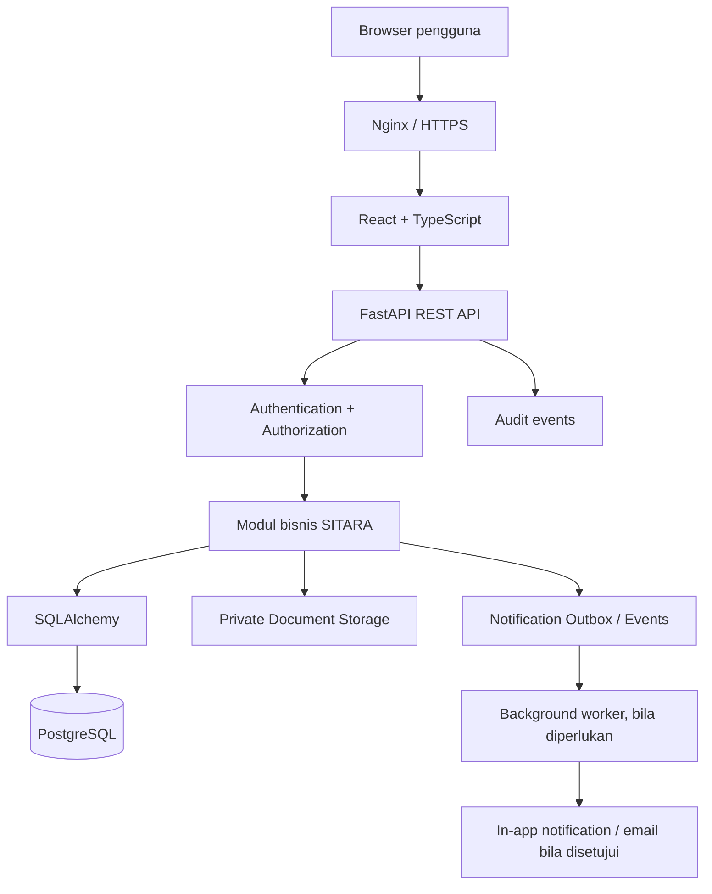

# SITARA — Architecture

**Versi:** 1.0-draft · **Tanggal:** 14 Oktober 2026  
**Gaya arsitektur:** modular monolith, API-first, role- and object-aware authorization.

## 1. Tujuan dan prinsip

Dokumen ini menjelaskan stack, batas modul, aliran request, keamanan, rancangan data, pengujian, dan deployment SITARA. Desain ditujukan agar dapat dikembangkan satu developer dengan bantuan AI agent tanpa membangun infrastruktur yang terlalu kompleks.

Prinsip:

- Modular monolith dahulu; tidak memecah layanan sebelum ada kebutuhan yang terbukti.
- PostgreSQL sebagai sumber data utama yang konsisten.
- Server-side authorization setiap request dan setiap akses objek/dokumen.
- Database schema changes hanya melalui migrasi Alembic.
- Private document storage dipisah dari direktori web publik.
- TDD, test negatif, scanner, dan code review menjadi quality gate.
- Draf AI/OCR tidak dapat menggantikan keputusan atau pengesahan manusia.

## 2. Stack teknologi

| Lapisan | Teknologi | Status/kegunaan |
|---|---|---|
| Frontend | React + TypeScript + Vite | Sudah menjadi baseline proyek. |
| Styling | CSS token/global CSS pada starter; Tailwind CSS dapat diadopsi setelah integrasi terencana | Jangan mencampur dua pendekatan styling secara acak. Jika mengadopsi Tailwind, dokumentasikan perubahan dependency dan standar komponen. |
| Komponen UI | Komponen internal sederhana; shadcn/ui sebagai opsi yang perlu ditambahkan secara eksplisit | Belum terpasang pada starter saat dokumen ini ditulis. |
| API/backend | FastAPI + Pydantic Settings | Baseline backend. |
| ORM | SQLAlchemy 2.x | Akses dan transaksi database. |
| Migrasi | Alembic | Riwayat skema yang terversi. |
| Database | PostgreSQL | Data relasional utama. |
| Test backend | pytest, pytest-cov, HTTPX TestClient | Unit/API/integration testing. |
| Quality backend | Ruff, mypy | Lint, format, dan type checking. |
| Test frontend | Vitest, React Testing Library | Unit/component test. |
| Quality frontend | ESLint, Prettier, TypeScript | Lint, format, build/type check. |
| Secret scanning | Gitleaks | Pre-commit dan CI; instalasi lokal perlu diverifikasi developer. |
| Security analysis | Semgrep, `npm audit`, `pip-audit` | Static analysis dan audit dependency. |
| CI | GitHub Actions | Quality/security gates. |
| Database lokal | Docker Compose PostgreSQL | Development/testing; bukan database production. |
| Production edge | Nginx + TLS pada Cloud VPS | Reverse proxy, terminasi HTTPS, dan routing frontend/API. |

Versi dependency dikunci dengan lockfile yang sesuai. Backend perlu menghasilkan lock/constraints yang dapat direproduksi sebelum deployment produksi; frontend harus meng-commit `package-lock.json` dan menggunakan `npm ci` di CI setelah lockfile tersedia.

## 3. Diagram container dan request



Pada MVP, satu deployment backend modular cukup. Background worker terpisah dapat ditambahkan ketika OCR, pengiriman notifikasi, atau jadwal pengingat memerlukan proses asynchronous yang andal. Jangan mengirim email atau melakukan OCR berat di jalur request jika hal itu membuat request menggantung.

## 4. Batas modul backend

Usulan struktur bertahap di dalam `backend/app/`:

```text
app/
  main.py
  api/
    routes/
      health.py
      auth.py
      meetings.py
      agendas.py
      decisions.py
      action_items.py
      documents.py
      notifications.py
      reports.py
  core/
    config.py
    security.py
    permissions.py
    logging.py
  db/
    session.py
    base.py
  models/
    user.py
    role.py
    organization.py
    meeting.py
    decision.py
    task.py
    document.py
    audit.py
  schemas/
  repositories/
  services/
  policies/
  tests/
```

Ini adalah target perkembangan, bukan perintah untuk membuat semua file kosong saat ini. Tambahkan modul ketika fitur terkait dikerjakan. Layer yang disarankan:

- **API/router:** HTTP, dependency, status response, validasi boundary; jangan memuat alur bisnis besar.
- **Schema:** Pydantic input/output; jangan mengembalikan model ORM mentah ke publik.
- **Service/use case:** aturan bisnis dan transaksi lintas objek.
- **Repository/data access:** query kompleks yang perlu dipisahkan atau digunakan ulang; hindari repository wrapper tanpa nilai tambah.
- **Model:** constraint relasi dan representasi domain database.
- **Policy/authorization:** keputusan izin terpusat dan dapat diuji.

Gunakan design pattern hanya bila menyelesaikan kebutuhan nyata, misalnya policy object untuk beberapa aturan akses, adapter untuk penyimpanan dokumen, atau service untuk transaksi lintas tabel. Jangan menambah abstraction hanya untuk terlihat enterprise.

## 5. Batas modul frontend

Target perkembangan:

```text
frontend/src/
  app/                 # router, provider, app shell
  components/          # komponen generik dan aksesibel
  features/
    auth/
    dashboard/
    meetings/
    minutes/
    decisions/
    action-items/
    approvals/
    documents/
    notifications/
    reports/
  lib/                 # API client, format, helpers
  styles/              # design tokens/global styles
  test/                # test setup dan helpers
```

Folder `features` membatasi komponen/domain agar modul tidak saling mengimpor implementasi internal sembarangan. Jangan pindahkan semua kode starter sekaligus tanpa fitur yang membutuhkannya; struktur bertambah secara inkremental.

## 6. Gambaran model data

Entitas inti:

- Organisasi/akses: `users`, `roles`, `permissions`, `user_roles`, `role_permissions`, `units`, `user_units`, `reporting_lines`, `user_sessions`.
- Rapat: `meetings`, `meeting_participants`, `meeting_external_participants`, `agendas`, `meeting_status_events`, `minutes_revisions`, `minutes_reviews`, `minutes_discussions`, `minutes_decisions`, `decision_brief_versions`, `decision_brief_decisions`, `document_versions`.
- Tindak lanjut: `action_items`, `assignments`, `progress_updates`, `approvals`, `status_histories`, `task_notes`.
- Dokumen dan aktivitas: `documents`, `notifications`, `audit_logs`, `document_templates`; login attempt counters use `login_rate_limit_buckets`.

Relasi konseptual:

```text
Meeting 1 ── N Agenda 1 ── N Discussion 1 ── N Decision
Decision 1 ── 0..N Action Item 1 ── N Assignment
Assignment 1 ── N Progress Update
Action Item 1 ── N Approval / Status History / Task Note
Meeting/Action Item/Progress Update ── Documents sesuai jenis dan hak akses
User ── Roles / Units / Reporting Lines / Notifications / Audit Events
```

Setiap `minutes_revision` adalah snapshot lengkap dengan `format_version` 1 (teks lama) atau 2 (terstruktur per agenda). Format 2 tidak menggunakan `content`; baris `minutes_discussions` terikat ke agenda dan revisi dari rapat yang sama, sedangkan `minutes_decisions` terikat ke pembahasan di revisi yang sama. Setiap putusan dapat menyimpan PIC usulan dan PIC pendukung opsional sebagai teks bebas, bukan assignment pengguna. Putusan pada revisi berikutnya mendapat identitas baris baru; perubahan tidak menulis ulang snapshot atau pemeriksaan historis. `decision_brief_versions` menyimpan versi editorial append-only dengan referensi revisi sumber; `decision_brief_decisions` menyimpan pilihan, prioritas, dan catatan editorial sambil mengambil teks keputusan dari revisi sumber. Composite foreign keys menjaga keputusan sumber tetap berada pada rapat dan revisi yang sama. Versi brief tidak mengubah data notulensi; status usang dihitung dari perbedaan ID revisi sumber dengan revisi notulensi aktif.

**Penting: koreksi sebelum menjadikan SQL draft sebagai migrasi produksi.** File `docs/sitara_schema_v1_draft.sql` saat ini mendefinisikan `action_items.decision_id` sebagai `UNIQUE`, yang berarti satu putusan hanya dapat menghasilkan satu action item. Kebutuhan produk adalah satu putusan dapat menghasilkan beberapa action item dengan progres terpisah. Karena itu, kolom tersebut harus menjadi foreign key non-unique dan relasi/constraint terkait harus diperbarui sebelum membuat model SQLAlchemy/Alembic final. Jangan menjalankan draft SQL itu langsung di production.

Untuk `is_action_item`, validasi konsistensinya dalam service/transaksi dan tambahkan constraint trigger bila desain database final memerlukannya. Operasi yang membuat/menghapus action item dan mengubah keputusan harus atomik dan menyimpan audit event.

### 6.1 Model status

`action_items.official_status` hanya menggunakan:

- `BELUM_DIMULAI`
- `BERPROSES`
- `TERKENDALA`
- `MENUNGGU_ACC`
- `SELESAI`

Simpan perubahan dalam `status_histories` dengan `old_status`, `new_status`, `changed_by`, waktu, dan catatan. Hanya pengguna aktif Sekretariat atau Manager Legal yang berwenang boleh mengubah status resmi melalui API; PIC dan Super Admin ditolak, termasuk pada akun campuran. Perubahan status, history, audit, dan informasi `completed_at` harus berada dalam transaksi yang sama. `SELESAI` mensyaratkan record verifikasi Sekretariat atau Manager Legal.

### 6.2 Assignment dan delegasi

Satu tugas memiliki satu PIC utama aktif dan dapat memiliki beberapa PIC pendukung. `assignments` menyimpan penerima akun atau `assignee_display_name` untuk PIC yang tidak memiliki akun. Sekretariat dan Manager Legal aktif tanpa `SUPER_ADMIN` dapat membuat atau mengelola tindak lanjut dan menetapkan PIC dari roster inti tujuh pengguna yang memiliki keanggotaan unit aktif; Rektor/Warek dapat menjadi PIC tetapi tidak dapat membuat atau menetapkan tindak lanjut. PIC dan Super Admin tidak mewarisi kewenangan pengelola pada akun campuran. Unit penanggung jawab tidak wajib untuk tugas baru; nilai yang sudah tersimpan tetap dipertahankan. PIC akun memilih unit asal dari keanggotaan aktifnya, sedangkan PIC nama bebas tidak memiliki unit asal terverifikasi. Alasan penugasan opsional dan tidak dicatat dalam audit umum. Kolom provenance nullable dipertahankan untuk riwayat legacy. Migration `0019_assignment_audit` mencatat assignment, penggantian PIC utama, dan pengakhiran PIC pendukung sebagai event dalam transaksi yang sama. Sekretariat dan Manager Legal yang berwenang dapat mengubah status resmi tugas.

### 6.3 Fondasi organisasi aktif

Migration `0008_organization_scope` menambahkan `organization_units`, `user_unit_memberships`, dan `reporting_lines`. Keanggotaan dan garis pelaporan memiliki waktu efektif UTC dengan rentang setengah terbuka `[valid_from, valid_until)`. Unit dapat memiliki parent, sementara satu pengguna dapat memiliki beberapa keanggotaan dan atasan aktif untuk mendukung struktur matriks. Migration tidak mengisi unit, pegawai, atau garis pelaporan production; data tersebut menunggu bagan dan roster yang disetujui. Pengecualian terbatas untuk demo/test: seed opt-in dapat membuat tiga PIC sintetis, unit `SITARA-DEMO`, dan reporting line dari semua akun seed Rektor/Warek hanya pada database testing disposable yang terpisah. Seed ini tidak mengubah role, API, atau kebijakan authorization production.

Helper `app.services.organization` mengecek akun aktif dan role yang dibaca dari database. Direktori PIC untuk tindak lanjut hanya mengembalikan pengguna inti aktif dengan keanggotaan unit aktif; hanya Sekretariat dan Manager Legal yang dapat melihat direktori dan menetapkan assignee. Setiap assignment tetap divalidasi di server. PIC berbentuk nama bebas disimpan dalam histori assignment tanpa user ID. PIC berakun dibatasi pada tugas yang memuat dirinya sebagai PIC utama/pendukung aktif. Rektor dan Warek dapat membaca serta memantau tugas dalam cakupannya, dan dapat menjadi assignee; mereka tidak dapat membuat atau menetapkan tugas. Kolom organisasi dan garis pelaporan tetap dipertahankan untuk data historis serta fitur organisasi lain; formulir tindak lanjut Rapim saat ini tidak meminta unit.

Sebelum data organisasi diprovisikan, pemilik proses perlu memberikan bagan unit dan roster pegawai. Proses provisioning berikutnya harus memvalidasi periode tumpang tindih dan siklus hierarki serta mencatat perubahan secara audit. Migration menjaga data dengan FK `RESTRICT` dan menolak downgrade ketika ada baris organisasi.

## 7. Autentikasi dan otorisasi

### 7.1 Autentikasi

Rekomendasi awal: sesi server-side dengan token acak berentropi tinggi. Token hanya disimpan sebagai cookie dengan `HttpOnly`, `Secure` di production, dan `SameSite` sesuai kebutuhan; simpan hash token sesi di database. Logout/pencabutan sesi harus membuat token lama tidak berlaku. CSRF protection diperlukan untuk request yang mengubah data ketika auth menggunakan cookie. Password disimpan dengan algoritma hash kata sandi yang sesuai (contohnya Argon2id melalui library terpelihara), bukan enkripsi reversible.

Frontend membaca cookie `sitara_csrf` non-HttpOnly dari halaman same-origin dan mengirim nilainya sebagai `X-CSRF-Token`. Cookie CSRF memakai `Path=/` agar dapat dibaca oleh SPA di root; cookie sesi tetap dibatasi ke `/api/v1`. Vite meneruskan `/api/v1` ke backend lokal, dan production reverse proxy harus merutekan API pada origin frontend yang sama.

Jangan simpan access/refresh token berumur panjang di `localStorage`. Konfigurasi cookie/CORS harus spesifik untuk origin yang disetujui.

### 7.2 Authorization

Terapkan kombinasi role-based access control dan object-level authorization:

1. Apakah pengguna sudah terautentikasi dan aktif?
2. Apakah peran memiliki izin fungsi?
3. Apakah pengguna berwenang pada rapat/tugas/dokumen yang diminta?
4. Apakah status objek dan workflow mengizinkan tindakan itu?

Menyembunyikan tombol di frontend hanya membantu UX dan tidak dianggap security boundary.

### 7.3 Aturan penting

- Pengguna aktif Sekretariat, Manager Legal, Rektor, dan Warek dapat membaca semua Rapim, notulen lengkap, dan Decision Brief; PIC dan Super Admin tetap ditolak, termasuk pada akun campuran.
- Sekretariat, Manager Legal, Rektor, dan Warek dapat menambahkan revisi notulen selama rapat `LIVE`; PIC dan Super Admin tetap ditolak. Notulis opsional dicatat saat rapat dibuat untuk atribusi, bukan sebagai gerbang edit. Konflik revisi usang tetap ditolak oleh kontrol `base_revision_id`.
- Sekretariat, Manager Legal, dan Warek dapat membuat rapat. Nomor rapat dapat diubah oleh ketiga peran pada semua status; field metadata lain hanya pada `DRAFT`/`LIVE`. Status rapat dikelola Sekretariat atau Manager Legal.
- Hanya Sekretariat dan Manager Legal dapat membuat/mengelola Action Item; Rektor membaca dan Warek tidak dapat membuat tindak lanjut. PIC dipilih sebagai user inti atau nama bebas.
- Pengguna aktif Sekretariat atau Manager Legal tanpa role `SUPER_ADMIN` dapat mencatat pemeriksaan notulensi dan mengelola status rapat; pemeriksa yang sama boleh melakukan finalisasi.
- Notulen disimpan sebagai snapshot append-only per revisi dengan urutan rapat. `format_version=1` menjaga teks lama tetap terbaca; `format_version=2` menyimpan pembahasan dan putusan terstruktur per agenda sebagai baris turunan immutable. Composite foreign key membatasi setiap pembahasan ke agenda dan revisi rapat yang sama serta setiap putusan ke pembahasan dalam revisi yang sama. Trigger migration menolak update/delete, dan PostgreSQL juga menolak `TRUNCATE`. Penulis mengirim `base_revision_id`; service mengunci rapat dan mengembalikan `409` jika base sudah usang.
- Pemeriksaan menyimpan `minutes_revision_id`; composite foreign key memastikan revisi berasal dari rapat yang sama. Finalisasi `LIVE → FINAL` mengunci rapat dan mensyaratkan pemeriksaan terbaru `VALID` pada revisi aktif. Revisi baru otomatis membuat pemeriksaan lama tidak memenuhi syarat tanpa mengubah riwayatnya.
- Endpoint isi/revisi dan Decision Brief mengembalikan konten untuk Sekretariat, Manager Legal, Rektor, dan Warek pada semua Rapim. PIC dan Super Admin ditolak, termasuk ketika memiliki role lain. Keempat peran inti dapat menyimpan satu snapshot lengkap melalui endpoint revisi yang sama selama `LIVE`. Decision Brief menggunakan API `POST/GET /meetings/{meeting_id}/decision-briefs`; seluruh pengguna inti dapat membaca histori, sedangkan pembuatan dan perubahan mengikuti hak tulis yang ditetapkan. Setiap putusan sumber wajib tercakup dalam Decision Brief yang terkait dengan revisi tersebut. Revisi berkonflik tetap mendapat `409`; belum ada kolaborasi real-time.
- Super Admin tidak otomatis mendapatkan izin bisnis untuk mengubah status tugas.
- Sekretariat dan Manager Legal aktif tanpa `SUPER_ADMIN` berwenang mengubah status resmi; PIC dan Super Admin ditolak, termasuk pada akun campuran.
- Akses ekspor dan unduh file tunduk pada policy yang sama dengan detail data.
- Akun/role/session changes dicatat; jangan menyimpan kredensial atau konten dokumen penuh dalam audit log.

## 8. API conventions

- Prefix API: `/api/v1`.
- Gunakan resource plural dan HTTP method sesuai semantik: `GET`, `POST`, `PATCH`, `DELETE` sesuai izin dan kebijakan retensi.
- Gunakan response schema eksplisit dan pagination server-side untuk koleksi besar.
- Format error konsisten, tidak membocorkan stack trace atau keberadaan data terlarang.
- `401` untuk autentikasi yang tidak valid/tidak ada; `403` atau `404` yang dipilih konsisten untuk penolakan akses objek agar tidak membocorkan keberadaan data.
- Gunakan idempotency untuk operasi yang berisiko diduplikasi, misalnya event pengiriman notifikasi atau submit tertentu.
- Perubahan bisnis penting menghasilkan audit event dalam transaksi yang sama bila memungkinkan.

## 9. File storage dan dokumen

- Metadata dokumen disimpan di PostgreSQL; isi file ditempatkan di storage privat.
- Bukti Action Item menggunakan `ACTION_ITEM_EVIDENCE_STORAGE_PATH`, berupa path absolut ke direktori privat di luar webroot. Upload gagal tertutup bila path belum dikonfigurasi; backend tidak menyediakan URL file publik.
- Simpan file dengan key acak, permission direktori/file privat, dan tulis atomik. PostgreSQL menyimpan metadata, checksum, key internal, pengunggah, waktu, dan progress update terkait.
- Bukti Action Item menerima PDF, JPEG, PNG, HEIC/HEIF asli, DOCX, XLSX, PPTX, CSV, dan TXT; ukuran maksimal 10 MiB per file dan lima bukti gabungan file/tautan per progress update. Office dibatasi ke OOXML modern tanpa macro.
- Validasi memeriksa signature dan struktur format yang diperlukan, menolak dokumen malformed yang terdeteksi, serta tidak mempercayai MIME browser. Ini bukan parser/sanitizer bersertifikasi dan tidak menggantikan antivirus; format kompleks seperti PDF, gambar, dan dokumen OOXML tetap harus dipindai sebelum akses.
- Tautan bukti harus HTTPS. Backend hanya menyimpan dan menampilkan tautan dalam scope terotorisasi; server tidak mengambil, mem-preview, atau mem-proxy URL tersebut.
- Unduhan file hanya melalui endpoint FastAPI terotorisasi dan selalu sebagai attachment. Simpan file di filesystem privat VPS; deployment harus memastikan direktori tidak dipetakan oleh web server/reverse proxy.
- File baru masuk karantina `PENDING`; unduhan ditolak sampai worker ClamAV mencatat hasil terminal untuk SHA-256 yang sama. Worker hanya mencatat `CLEAN` setelah daemon menjawab `OK`; temuan malware menghasilkan `REJECTED`. Timeout, scanner/storage failure, file hilang/berubah/terlalu besar, dan checksum mismatch tidak menghasilkan `CLEAN`. Download kembali memeriksa status scan, ukuran, dan SHA-256 dari byte yang dibaca. Migration `0011_evidence_scan_quarantine` membuat event `PENDING` bagi file lama. Hasil scan hanya dicatat melalui service internal; tidak ada endpoint publik untuk mencatat hasil.
- Compose menyediakan satu `evidence-scanner` yang mengakses shared evidence volume read-only dan daemon ClamAV melalui jaringan scanner internal. API dan worker memakai jaringan database terpisah; PostgreSQL terhubung ke keduanya, tetapi worker tidak berbagi jaringan dengan API. ClamAV tidak terhubung ke jaringan database dan hanya juga bergabung ke jaringan egress untuk FreshClam. Query queue saat ini tidak mengklaim atau menyewakan event `PENDING`; service result mengunci row evidence agar hanya satu hasil terminal yang tercatat, tetapi tidak mencegah dua proses memindai file yang sama jika berjalan tumpang tindih. Jangan menambah replica sebelum ada atomic claim/lease dan test konkurensi worker. Healthcheck ClamAV hanya membuktikan daemon merespons ping, bukan kesegaran signature; pemantauan freshness perlu ditetapkan untuk production.
- Backend menolak request upload evidence di atas 11 MiB sebelum parsing jika `Content-Length` tersedia dan saat body diterima jika transfer bersifat streaming. Batas file individual tetap 10 MiB; sisa request mengakomodasi multipart boundary dan metadata. Nginx deployment harus mengatur `client_max_body_size 11m` pada lokasi API yang tepat, meneruskan error `413`, dan tidak men-buffer body tanpa batas. Batas di reverse proxy adalah perlindungan tambahan, bukan pengganti middleware aplikasi.
- Untuk VPS, set `ACTION_ITEM_EVIDENCE_STORAGE_PATH` ke direktori absolut pada filesystem privat di luar webroot, misalnya `/var/lib/sitara/private-evidence`. Buat direktori dengan owner user backend dan mode `0700`; file dibuat dengan mode `0600`. Jangan menambahkan path tersebut sebagai Nginx `alias`/static root atau mount publik. Pastikan direktori berada pada volume persisten, kapasitas dan inode dipantau, dan path tidak melewati symlink.
- Compose lokal sudah menyediakan worker terpisah dan internal ClamAV. Deployment production tetap perlu menyiapkan worker tanpa endpoint publik, akses minimum ke database dan storage, pemantauan signature FreshClam, serta pemulihan/pemindaian ulang setelah restore. Worker hanya membaca file karantina dan mencatat nama/versi engine serta hash yang dipindai; `REJECTED` tetap tidak dapat diunduh. Tanpa scanner yang berhasil, status tetap `PENDING` (fail-closed).
- Metadata dan histori bukti bersifat append-only. Perubahan bukti dilakukan dengan menambahkan entri; downgrade migration ditolak bila evidence atau progres pimpinan sudah tercatat.
- File asli, checksum, versi, pengunggah, waktu, keterkaitan rapat/tugas, serta klasifikasi akses perlu dapat ditelusuri.
- Backup database dan file harus dikoordinasikan agar metadata tidak merujuk ke file yang tidak ada; enkripsi dan uji restore mencakup keduanya. Proses rekonsiliasi file yatim/crash antara penulisan filesystem dan commit metadata, serta kebijakan retensi/penghapusan, perlu ditetapkan sebelum produksi. Jangan hapus file hanya berdasarkan pemindaian direktori tanpa membandingkan metadata database dan status karantina.

## 10. Notifikasi, OCR, dan ekspor

### Notifikasi

Notifikasi in-app disimpan di database. `GET /api/v1/notifications` hanya mengembalikan record milik pengguna aktif beserta jumlah yang belum dibaca; `POST /api/v1/notifications/{id}/read` hanya dapat mengubah record milik pengguna tersebut. Peristiwa perubahan status Action Item ditujukan kepada PIC aktif terkait. Peristiwa review Decision Brief ditujukan kepada penulis/reviewer yang berkaitan dan berwenang. Pesan bersifat generik: tidak memuat judul tugas/rapat, isi dokumen, atau alasan penolakan. Komponen top bar menampilkan jumlah belum dibaca, tautan menuju objek target, dan aksi tandai dibaca; otorisasi endpoint target tetap menjadi batas keamanan.

Notifikasi dibuat dalam transaksi bisnis untuk perubahan status Action Item dan workflow review Decision Brief. Email opsional dikirim melalui worker SMTP terpisah dari antrean durable pada tabel notifikasi; pengiriman mati secara default dan hanya notifikasi baru yang masuk antrean ketika diaktifkan. Worker memakai TLS, retry dengan batas percobaan, dan menyimpan hanya status serta tipe error tanpa detail SMTP. Isi email berasal dari teks generik berdasarkan tipe notifikasi, bukan isi bebas atau metadata objek. Override penerima untuk percobaan hanya diizinkan pada development/testing. Kredensial SMTP hanya diberikan ke worker melalui environment; jangan menaruhnya di source atau mengirimkannya melalui chat.

Untuk uji Gmail lokal, gunakan `smtp.gmail.com:587`, akun pengirim dan Google App Password melalui `.env` lokal, serta override penerima hanya pada development/testing. Jalankan worker Compose dengan profile `notification-email`. Jangan aktifkan override pada production. Pengingat tenggat otomatis belum diimplementasikan.

### OCR dan AI

OCR/AI bukan dependensi untuk workflow inti. OCR membuat draf hasil ekstraksi untuk dikonfirmasi. AI, bila disetujui, membuat saran Decision Brief dari data yang diizinkan. Jangan kirim notulen terbatas ke layanan eksternal tanpa persetujuan, evaluasi retensi, dan perlindungan data.

### PDF/CSV/XLSX

Buat lapisan renderer/template terpisah dari service bisnis. Format ekspor formal harus diuji pada contoh resmi: ukuran halaman, margin, header/logo, tabel panjang dengan repeating header, page number, dan blok pengesahan. Pilih library akhir setelah proof-of-concept membuktikan hasil yang cocok. Ekspor tabel tetap tunduk pada permission dan field-level access.

## 11. Test strategy dan quality gates

Urutan minimal untuk setiap fitur:

1. Tuliskan acceptance criteria dan test.
2. Jalankan test baru untuk membuktikan test gagal karena fitur belum ada (Red).
3. Implementasi minimal (Green).
4. Refactor tanpa mengubah semantik yang diuji.
5. Jalankan test terfokus lalu regresi.
6. Jalankan lint, formatter, type check, frontend build/test, audit dependency, dan scanner sesuai ruang perubahan.
7. Review apakah test memvalidasi output/perilaku dan skenario negatif.

Lapisan test:

- Unit: domain/service/helper.
- API/integration: request nyata ke FastAPI dengan database test terisolasi.
- Authorization negative: PIC vs notulen/status/dokumen, pengguna lintas tugas/unit, akun nonaktif, sesi kedaluwarsa.
- Frontend component: form, state, permission-aware UI, error/loading.
- E2E: skenario kritis lintas login, task, proof, verification, and export.
- Migration: upgrade dari database kosong dan skenario upgrade versi sebelumnya.

Tools: `pytest`, `pytest-cov`, `HTTPX TestClient`, `Vitest`, `React Testing Library`, `ESLint`, `Prettier`, `tsc -b`, `Ruff`, `mypy`, `Gitleaks`, `Semgrep`, `npm audit`, `pip-audit`, dan Trivy saat container build/deployment disiapkan. Scanner belum dianggap terpasang/berhasil sampai output nyata tersedia.

## 12. Environment dan deployment

### Local

- Windows + VS Code dapat digunakan untuk development.
- PostgreSQL melalui Docker Compose.
- `.env` lokal tidak dikomit; `.env.example` hanya placeholder.
- Gunakan database test terpisah dari database development.
- Test destructif tidak pernah menunjuk ke environment production.

### CI

Pull request menjalankan lint, format check, type checks, tests, build, secret scan, SAST, dan dependency audit. Lockfile wajib disimpan dan dependency installation harus reproducible.

### Production Cloud VPS

- Nginx/reverse proxy dengan TLS.
- Backend dijalankan sebagai user non-root dengan dependency yang dipasang terkunci.
- Database tidak dibuka langsung ke internet; gunakan kredensial least-privilege.
- Secrets tersedia melalui environment/secret manager, bukan image atau repository.
- `ACTION_ITEM_EVIDENCE_STORAGE_PATH` harus menunjuk volume privat persisten di luar webroot; batasi akses backend, scanner, dan backup sesuai kebutuhan minimum. Konfigurasikan batas reverse proxy 11 MiB dan verifikasi request besar ditolak di edge maupun aplikasi.
- Scanner antivirus harus tersedia, terpantau, dan terhubung sebelum mengizinkan bukti dibagikan; jika belum tersedia, unduhan tetap tertutup. Rencanakan pemulihan karantina dan pemindaian ulang setelah restore.
- Firewall hanya membuka port yang diperlukan.
- Backup terenkripsi ke lokasi terpisah dari VPS dan uji restore.
- Log terstruktur, health check, monitoring resource/error, dan rotasi log.
- Staging harus menyerupai production namun berisi data sintetis.

## 13. Backup, recovery, dan rollback

- Backup PostgreSQL dan file privat secara terpisah tetapi dengan prosedur koordinasi yang mencegah ketidaksesuaian.
- Tentukan RPO/RTO bersama pemilik sistem sebelum production.
- Enkripsi backup dan batasi akses; simpan salinan di luar akun/server production.
- Uji restore ke environment terisolasi secara berkala.
- Simpan nomor versi release dan riwayat migrasi.
- Perubahan database berisiko menggunakan strategi expand–migrate–contract; jangan mengasumsikan kode rollback otomatis membatalkan migrasi database.
- Tidak ada pengujian restore, migrasi destruktif, atau scanner aktif yang membebani data production tanpa prosedur dan persetujuan.
- Stage 7.4.12 menetapkan rancangan recovery point: custom-format PostgreSQL archive dan private-evidence archive harus ditangkap dalam satu periode quiesce, dienkripsi sebelum dipindahkan, diverifikasi dengan SHA-256, lalu direstore dan direkonsiliasi pada resource disposable. Rinciannya ada di [`MIGRATION_PLAN.md`](./MIGRATION_PLAN.md).
- HDD eksternal adalah media offline prioritas yang direncanakan; OneDrive Microsoft 365 kampus adalah fallback/opsi terakhir. SharePoint Document Library khusus SITARA tidak tersedia dan belum ada aplikasi Entra ID untuk Graph, sehingga bila disetujui, petugas mengunggah ciphertext secara manual ke folder OneDrive dengan akses terbatas. Ketersediaan HDD, kapasitas, retensi, recovery kampus, dan persetujuan produksi tetap belum terverifikasi.
- Super Admin/operator yang ditunjuk menjalankan dan memantau backup; Direktur menyetujui kebijakan dan pemulihan produksi; IT bertanggung jawab atas infrastruktur/storage; kustodian kunci yang ditunjuk resmi mengelola pemulihan kunci secara terpisah. Kandidat enkripsi recipient-based `age` tetap PROPOSED sampai disetujui dan diuji. Tanggung jawab ini tidak menambah hak bisnis Super Admin di SITARA.
- Retensi 14 harian, 8 mingguan, 12 bulanan dan uji restore bulanan tetap PROPOSED; jangan aktifkan pruning otomatis. VPS belum tersedia dan backup tooling belum diimplementasikan. Jangan menyebut SITARA siap backup/restore produksi sampai salinan terenkripsi pada destination yang disetujui berhasil direstore dari salinan yang sama.

## 14. Keputusan arsitektur yang sudah/masih terbuka

### Diputuskan

- Modular monolith.
- React + TypeScript + Vite; FastAPI; PostgreSQL; SQLAlchemy; Alembic.
- Nomor rapat dapat diedit oleh pengelola pada semua status; nomor agenda dibuat otomatis.
- Sekretariat, Manager Legal, Rektor, dan Warek dapat mengedit notulensi saat live; PIC dan Super Admin tetap tidak dapat membaca isinya.
- PIC utama dan satu atau lebih PIC pendukung.
- Sekretariat dan Manager Legal memverifikasi penyelesaian serta mengubah status resmi.
- Storage dokumen privat dan akses server-side.
- TDD dan CI security gates.

### Belum final

- Library styling final (baseline saat ini CSS; Tailwind/shadcn perlu penambahan eksplisit jika dipilih).
- Library PDF renderer setelah template prototipe diuji.
- Model deployment file storage final (private filesystem VPS vs object storage).
- Kanal notifikasi di luar in-app.
- Pilihan OCR dan model/penyedia AI dengan persetujuan kebijakan data.
- Target performa, RPO/RTO, retensi dan jumlah data pengguna.

## 15. Dokumen terkait

- Kebutuhan produk: [`PRD.md`](./PRD.md)
- Sistem visual: [`system_design.md`](./system_design.md)
- Petunjuk kerja AI: [`agents.md`](./agents.md)
- Skema awal (draft, belum untuk production): [`sitara_schema_v1_draft.sql`](./sitara_schema_v1_draft.sql)
